<p align="center">
  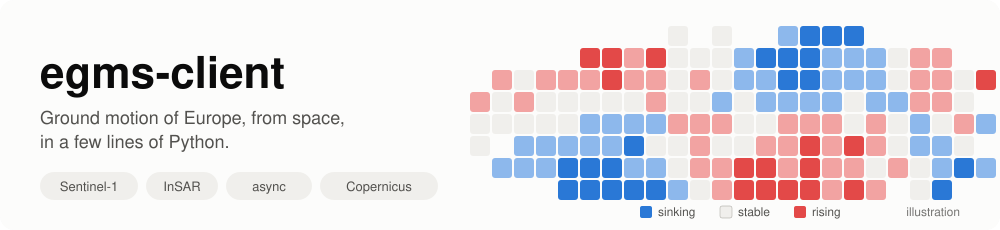
</p>

<p align="center">
  <a href="https://github.com/agent-engineering-studio/egms-client/actions/workflows/ci.yml"></a>
  <a href="https://pypi.org/project/egms-client/"></a>
  <a href="https://agentengineering.it/egms-client/"></a>
  
  
  <a href="https://github.com/agent-engineering-studio/egms-client/blob/main/LICENSE"></a>
</p>

**egms-client** is a small, typed, async Python library for the archive of
[EGMS](https://egms.land.copernicus.eu/), the **European Ground Motion
Service**. EGMS measures how much the ground moves, millimetre by millimetre,
across all of Europe, using radar satellites. This library lets you download
that data from a script, with no browser and no copy-pasted links.

```python
path = await archive.fetch_tile((47, 19), "U", "2020-2025", Path("egms"))
# egms/EGMS_L3_E47N19_100km_U_2020_2025_1.tiff  (vertical speed, mm/year)
```

---

## Contents

- [What is EGMS, in 30 seconds](#what-is-egms-in-30-seconds)
- [What this library does](#what-this-library-does)
- [Who is it for](#who-is-it-for)
- [Quick start](#quick-start)
- [Example notebooks](#example-notebooks)
- [A page for a Comune, in Docker](#a-page-for-a-comune-in-docker)
- [Where downloads are saved](#where-downloads-are-saved)
- [Time series as tables](#time-series-as-tables)
- [How it works](#how-it-works)
- [Recipes](#recipes)
- [The traps we already fell into](#the-traps-we-already-fell-into)
- [API at a glance](#api-at-a-glance)
- [With an AI assistant](#with-an-ai-assistant)
- [Contributing](#contributing) · [Ideas to work on](#ideas-to-work-on)
- [Data licence and credits](#data-licence-and-credits)

---

## What is EGMS, in 30 seconds

The Sentinel-1 satellites fly over Europe every few days and send down radar
pulses. Comparing the echoes from one pass to the next (a technique called
**InSAR**) shows whether a point on the ground moved closer or farther, down
to a few millimetres. Copernicus turns years of these measurements into
**maps of speed**: how fast the ground goes up or down, east or west, in
**millimetres per year**.

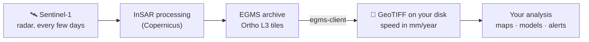

What you can see with it, for example:

- a **town that is sinking** because groundwater is pumped out (subsidence);
- a **slope that creeps** downhill before a landslide;
- a **bridge, dam or railway** that settles more than it should;
- the ground **rising** above a volcano or a gas storage site.

> Negative vertical speed (`U < 0`) means the ground goes **down**;
> positive means it goes **up**.

Here is real data, made with one command of this library. Around Pozzuoli
the Campi Flegrei caldera is **rising by up to 16 cm a year**, while Naples
and Vesuvius barely move:

<p align="center">
  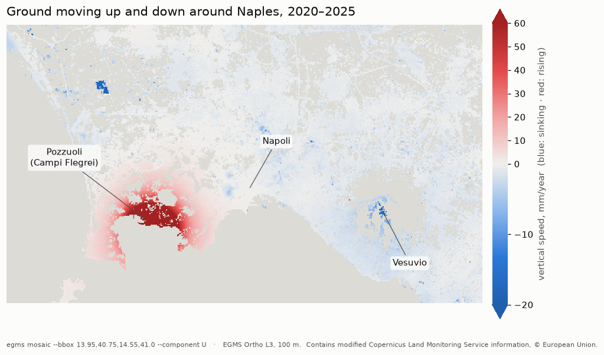
</p>

```bash
egms mosaic --bbox 13.95,40.75,14.55,41.0 --component U --out naples-U.tif
```

## What this library does

| | Feature | In plain words |
|---|---|---|
| 🔑 | **Login with a CLMS service key** | Your key file is all it needs, from a path or an environment variable. Tokens are created and renewed for you. |
| 🔎 | **Every product of the archive** | **L3** speed maps (vertical `U`, east-west `E`, 100 m grid) and **L2A / L2B** measurement points with their full time series. |
| 🗺️ | **Search by area in degrees** | Give a box in longitude/latitude; areas larger than the archive accepts are split for you. |
| 💾 | **Never download twice** | Files already on disk are skipped, interrupted runs resume, and you choose what to keep of each ZIP (`tiff`, `csv`, `xml`, `parquet` or the ZIP). |
| 📈 | **Time series as tables** | The CSVs in pandas, or straight to **GeoParquet** (a 250 MB CSV becomes ~60 MB) for GeoPandas, QGIS, DuckDB. |
| 🛡️ | **Safe by default** | Parallel downloads with a limit, automatic retries, a size check before the first byte. |
| 🖥️ | **Command line** | `egms search` and `egms download`, no Python needed. |
| 🧩 | **Mosaics** | Glue tiles into one array over any rectangle, with no resampling. |
| 🧪 | **Pure functions too** | Every step is also a plain function, if you have your own HTTP stack. |

## Who is it for

- **Researchers and students** in geology, geophysics and remote sensing who
  want EGMS data in a notebook or pipeline.
- **GIS and data engineers** who need to download a region or a whole
  country, repeatably.
- **Risk and infrastructure teams** (landslides, subsidence, monitoring of
  roads, railways, dams) who use ground motion as one input among many.

It started inside [Limen](https://github.com/agent-engineering-studio/limen),
where the vertical and east-west speeds of each 1 km cell are features of a
landslide-risk model, and was extracted so that anyone can use it.

---

## Quick start

### 1. Install

```bash
pip install egms-client           # login, search, download
pip install "egms-client[raster]" # + mosaics (numpy, rasterio, pyproj)
pip install "egms-client[tables]" # + CSVs as pandas / GeoParquet (pandas, pyarrow, pyproj)
pip install "egms-client[xarray]" # + maps and series as xarray DataArray
pip install "egms-client[mcp]"    # + an MCP server for AI agents (egms mcp)
```

Python 3.12 or newer.

### 2. Get a service key (once, 2 minutes)

EGMS is free for everyone, but the archive wants to know who downloads.
You need two things: an **EU Login** account (the European Commission's
login, one for all its services) and, with it, a **service key** of the
Copernicus Land Monitoring Service (CLMS).

**If you have no EU Login account yet:**

1. Open the [EU Login sign-up page](https://ecas.ec.europa.eu/cas/eim/external/register.cgi).
2. Fill in your name and e-mail, accept the privacy statement and send the form.
3. Open the e-mail you get, follow its link and choose a password. The
   account is personal and costs nothing.

**Then create the key:**

1. Go to [land.copernicus.eu](https://land.copernicus.eu/), click **Login**
   and sign in with EU Login. The first time, the portal may ask you to
   complete your profile and accept its terms of use.
2. Open your profile → **API Tokens** → *Create new token*, and give it a
   name you will recognise (e.g. `egms-client on my laptop`).
3. Save the JSON file you get, e.g. as `~/clms-service-key.json`, and make
   it readable only by you: `chmod 600 ~/clms-service-key.json`.

It contains `client_id`, `user_id`, `private_key` and `token_uri`, and it
**does not expire**. Treat it like a password: keep it out of git.

> The key is shown **only once**, right after *Create new token*: copy the
> whole JSON then. The token list shows only its `key_id`, which is not
> enough to log in.

Then tell egms-client where it is, with **one** of these environment
variables, so no code ever contains a path or a secret:

```bash
export EGMS_SERVICE_KEY_FILE=~/clms-service-key.json   # a file on disk
export EGMS_SERVICE_KEY="$(cat ~/clms-service-key.json)"  # or the JSON itself (CI, Docker secrets)
```

Good to know:

- **One key per place.** Create one token per machine or service (your
  laptop, a server, CI): if one leaks, delete only that one in the token
  list, and the others keep working.
- **Limits are per account.** The archive serves at most 2 downloads at a
  time per account, whatever key you use: egms-client keeps within it.
- **Lost the JSON?** It cannot be shown again: delete the token and create
  a new one.
- The variable names have **one** underscore: `EGMS_SERVICE_KEY_FILE`,
  not `EGMS__SERVICE_KEY_FILE` (that one is Limen's own setting).

### 3. Download your first tile

```python
import asyncio
from pathlib import Path

from egms_client import EgmsArchive


async def main() -> None:
    async with EgmsArchive() as archive:  # key from the environment
        print(await archive.releases())  # ['2020-2024', '2020-2025']

        path = await archive.fetch_tile((47, 19), "U", "2020-2025", Path("egms"))
        print(path)  # egms/EGMS_L3_E47N19_100km_U_2020_2025_1.tiff


asyncio.run(main())
```

That's it: `path` is a GeoTIFF of 1,000 × 1,000 pixels, each one the mean
vertical speed of a 100 m square, in mm/year.

### 3b. Or from the command line

```bash
egms releases
egms search   --level L2B --bbox 14.4,40.0,15.7,41.0     # what is there, and how many GB
egms download --tile E47N19 --component U --keep tiff --out egms
egms download --level L2B --bbox 14.4,40.0,15.7,41.0 --keep parquet --max-gb 10
egms convert  egms/EGMS_L3_E47N19_100km_U_2020_2025_1.csv   # a CSV you already have
egms mosaic   --bbox 13.95,40.75,14.55,41.0 --component U --out naples-U.tif   # a map, extra raster
```

`--bbox` is *west,south,east,north* in degrees. `download` and `mosaic` stop
before the first byte if the total is above `--max-gb` (10 by default), and
show their progress: one updating line in a terminal, a line per file in a
log.

`egms mosaic` downloads the L3 tiles a box touches (once: they stay in
`--data-dir`), pastes them, and writes a **Cloud-Optimized GeoTIFF** in
EPSG:3035 (float32, NaN as nodata, with overviews): drag it into QGIS, or
serve it over HTTP as is.

### 4. Make a mosaic and look at it

```python
from egms_client import tiles_for_bounds
from egms_client.mosaic import mosaic

# A rectangle in EPSG:3035 metres (here: exactly tile E47N19)
bounds = dict(minx=4_700_000, miny=1_900_000, maxx=4_799_999, maxy=1_999_999)


async def download(archive: EgmsArchive) -> list[Path]:
    tiffs = []
    for tile in tiles_for_bounds(*bounds.values()):
        path = await archive.fetch_tile(tile, "U", "2020-2025", Path("egms"))
        if path is not None:  # None: the tile is at sea or not covered
            tiffs.append(path)
    return tiffs


# ... after downloading:
vertical = mosaic(tiffs, **bounds)
print(vertical.values.shape, vertical.left, vertical.top)
# (1000, 1000) 4700000.0 2000000.0
```

Want a picture? With `pip install matplotlib`:

```python
import matplotlib.pyplot as plt

rows, cols = vertical.values.shape
extent = (
    vertical.left,
    vertical.left + cols * vertical.pixel,
    vertical.top - rows * vertical.pixel,
    vertical.top,
)
plt.imshow(vertical.values, cmap="RdBu_r", vmin=-10, vmax=10, extent=extent)
plt.colorbar(label="vertical speed (mm/year)")  # blue: sinking, red: rising
plt.title("EGMS Ortho L3 · E47N19 · 2020-2025")
plt.show()
```

---

## Example notebooks

Five stories with real data, from download to figure, in [`notebooks/`](https://github.com/agent-engineering-studio/egms-client/tree/main/notebooks). The last two run on the crops of the benchmark, with no key and no download (`make notebooks-offline`, and in CI):

| | |
|---|---|
| [**Campi Flegrei**](https://github.com/agent-engineering-studio/egms-client/blob/main/notebooks/01_campi_flegrei.ipynb) | a caldera rising +79 cm in five years near Pozzuoli |
| [**A landslide in Ancona**](https://github.com/agent-engineering-studio/egms-client/blob/main/notebooks/02_landslide_ancona.ipynb) | measurement points on a moving slope, against still ones |
| [**Bologna sinking**](https://github.com/agent-engineering-studio/egms-client/blob/main/notebooks/03_sinking_bologna.ipynb) | how much of the plain subsides, and how fast |
| [**How far to trust a velocity**](https://github.com/agent-engineering-studio/egms-client/blob/main/notebooks/04_how_much_to_trust.ipynb) | Rione Terra scores 1, the sea is not measured, a lone forest cell scores 0.03 |
| [**Cells for a model**](https://github.com/agent-engineering-studio/egms-client/blob/main/notebooks/05_cells_for_a_model.ipynb) | 74 % of the forest is not measured; the sign of the acceleration, against its magnitude |

<p align="center">
  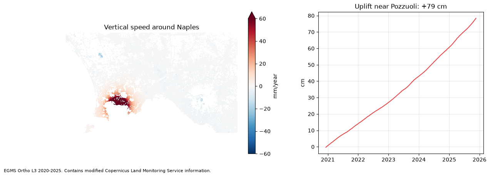
</p>

## A page for a Comune: open data side by side, in Docker

<p align="center">
  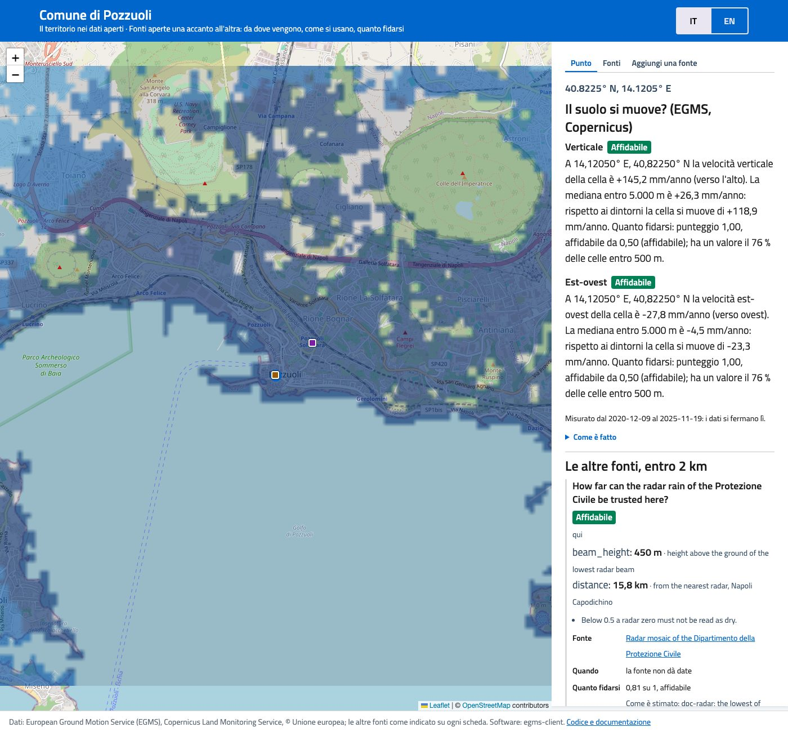
</p>

A page that shows how to reuse open data, for one area: the Comune and a
radius around it (`EGMS_UI_RADIUS_KM`, 10 km by default). Its EGMS tiles are
downloaded once, at startup, and the map stays inside it. The map fills the screen; click a
point and the panel gives one row per source: what it measures, its number
in words, and a dot for how far to trust it. EGMS says how much the ground
moves; next to it, the radar rain of the Protezione Civile, a landslide
threshold, a rain gauge. A row opens on its source, dates, licence and
notes. On a phone the panel is a sheet that slides up.

Whoever runs the page has a back office on another port (`127.0.0.1:3004`,
not published): upload a file, connect a sensor that sends SenML to
`POST /api/ingest/{id}` with its own token, and see what was refused and
why. It is off until `.env` names the administrator and the hash of the
password (`make admin-password`).

The technical side is on its own page, `/dati`: how each source is made,
the code to reuse it, the [records of open data](https://agentengineering.it/egms-client/api/records/),
and templates to download (JSON and CSV). A source joins without code: its
file goes in the folder `records/`, and a file with an invalid record is
refused. The sources stay side by side: the page does not blend them into a
score, and it is not an alert system.

It is in Italian and English, uses
[Bootstrap Italia](https://italia.github.io/bootstrap-italia/) served from
the image (no CDN), and can be embedded in an iframe.

```bash
cp .env.example .env      # the place, the name, the language; the key in ./secrets
make up                   # or: make demo, with no key, on the crops of the benchmark
```

| Container | Address (127.0.0.1 only) | What |
|---|---|---|
| `egms-client-ui` | http://127.0.0.1:3003 | the page (Next.js, Bootstrap Italia, Leaflet) |
| `egms-client-admin` | http://127.0.0.1:3004 | the back office: files and sensors, with the administrator of `.env` (off without it) |
| `egms-client-api` | inside Docker, port 8010 | `demo/api.py`: `facts` and `words` behind a few URLs |
| `egms-client-notebook` | http://127.0.0.1:8889 | JupyterLab on the notebooks (`--profile notebook`) |
| `egms-client-mcp` | http://127.0.0.1:8768/mcp | the MCP server over HTTP (`--profile mcp`) |

Every setting is in [`.env.example`](https://github.com/agent-engineering-studio/egms-client/blob/main/.env.example),
and the place can also come from the address:
`?lat=40.82&lon=14.12&place=Comune%20di%20Pozzuoli&lang=it&embed=1`. The
CLMS key is mounted read-only from `./secrets` and never copied into an
image. Without it the page runs on the crops of the benchmark, and outside
them it says "no data loaded here", which is not "not measured". For a
public body, in Italian: [riuso](https://agentengineering.it/egms-client/riuso/).
`make down` stops it; `make logs` follows it.

## How we know it works

Five places where the answer is already known, from sources outside EGMS:
Campi Flegrei rising, Bologna sinking, the Murge still, a forest where the
radar is blind, and the Ancona landslide. CI scores them offline on small
crops of the real archive: **21 of 23** checks pass, and the two that fail
are kept, because they show that a still place is not at zero east-west
(+1.6 mm/year at the Murge). See the
[benchmark](https://agentengineering.it/egms-client/benchmark/).

## Where downloads are saved

In the directory you pass (`directory` in Python, `--out` on the command
line). If you pass none:

1. `EGMS_DATA_DIR`, if set;
2. otherwise `~/.cache/egms-client` (or `$XDG_CACHE_HOME/egms-client`).

The directory is also the cache: whatever is already there is **not
downloaded again**, so the next run with the same request only asks the
archive for the list of files (a few KB) and returns.

In **Docker**, point it at a volume so the data survives the container:

```yaml
services:
  app:
    environment:
      EGMS_DATA_DIR: /data/egms
      EGMS_SERVICE_KEY_FILE: /run/secrets/clms_service_key
    volumes:
      - egms-data:/data/egms
    secrets:
      - clms_service_key
volumes:
  egms-data:
secrets:
  clms_service_key:
    file: ./clms-service-key.json
```

---

## How it works

### Tiles: how Europe is cut into squares

The Ortho L3 product lives on a single grid in **EPSG:3035** (the standard
equal-area projection for Europe). The grid is cut into 100 km squares, and
each square is named after its **lower-left corner, in hundreds of
kilometres**.

<p align="center">
  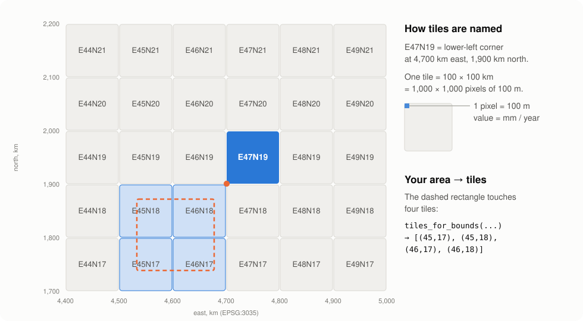
</p>

You never have to compute tile names by hand: give `tiles_for_bounds` a
rectangle and it returns every tile it touches.

```python
>>> tiles_for_bounds(4_530_000, 1_740_000, 4_670_000, 1_870_000)
[(45, 17), (45, 18), (46, 17), (46, 18)]
>>> tile_id((47, 19))
'E47N19'
```

### Logging in: the service key never leaves your machine

Your key signs a short-lived request (a JWT); the Copernicus server answers
with a token valid for one hour. `EgmsArchive` asks for a new one **five
minutes before it expires**, so a download of a whole country, which takes
longer than an hour, never stops halfway.

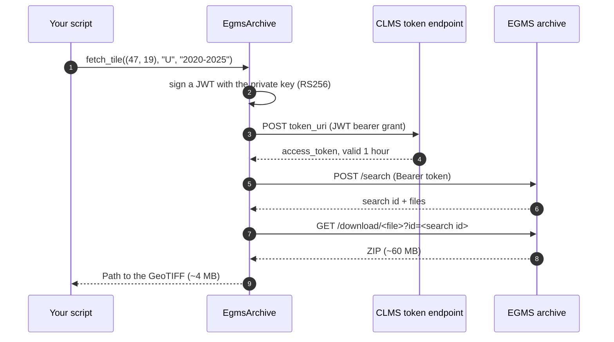

### Downloading: what `fetch_tile` decides

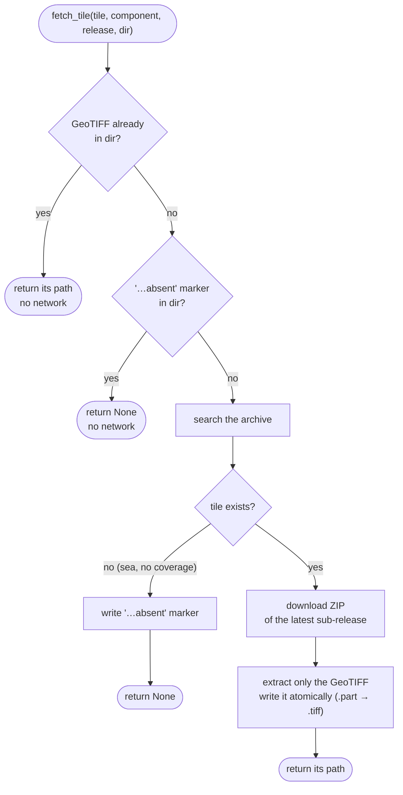

Because **both** outcomes are written to disk, running the same script again
over a whole country sends **zero requests**. And because the file is first
written as `.part` and then renamed, an interrupted run never leaves a
half-written GeoTIFF behind.

### Why it keeps only the GeoTIFF

<p align="center">
  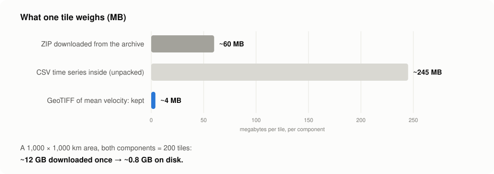
</p>

Each ZIP also holds a CSV with the full time series of every pixel. It is
large and most uses only need the mean speed, so `fetch_tile` leaves it out.
Need the time series? `fetch(..., keep=["parquet"])` keeps it as GeoParquet,
about a quarter of the CSV: see [Time series as tables](#time-series-as-tables).

### The building blocks

The library has two layers. You can use the high-level client, or call the
pure functions with any HTTP library you like.

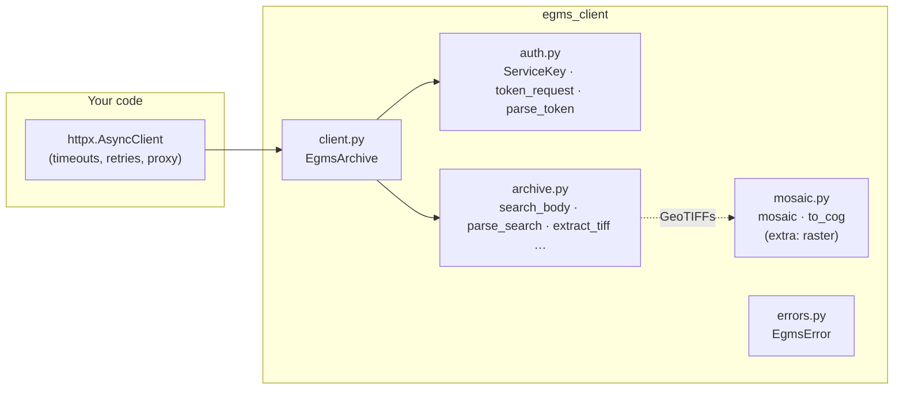

- **`auth.py`, `archive.py`**: pure functions, no network. They build
  requests and read answers. Easy to test, easy to reuse.
- **`client.py`**: `EgmsArchive` wires them to **your** `httpx.AsyncClient`.
  Timeouts, retries and proxies stay under your control.
- **`mosaic.py`**: optional, only needs `numpy`, `rasterio`, `pyproj`.

---

## Recipes

### The speed at one point

```python
point = await archive.velocity_at(14.12, 40.83)  # lon, lat in degrees: Pozzuoli
print(point.velocity, "mm/year")  # vertical, latest release, the 100 m cell
print(point.file)  # the L3 GeoTIFF it was read from
```

Only the point's tile is downloaded (once), so more points nearby cost
nothing. `component="E"` gives east-west. `velocity` is `None` where EGMS
has no measurement (sea, or a cell without data). Needs the `raster` extra.

### How far to trust a velocity

EGMS gives a velocity wherever the radar found something stable to
measure, and nothing elsewhere. `reliability.trust` says how much a number
at a point can be trusted, from what the archive gives:

```python
from egms_client.reliability import trust

r = trust(tiffs, 14.1205, 40.8225)  # the L3 GeoTIFFs around Pozzuoli
print(r.velocity, r.reliable, r.score)  # 145.2 True 1.0
print(r.coverage)  # 0.762: 76 % of the cells within 500 m have a value
print(r.regional_median, r.relative)  # 26.3, 118.9: against the 5 km around it
```

- `coverage` is the share of cells with a value within 500 m. In a forest
  it falls to a few per cent: a lone cell there is not to trust, and no
  cell is **not measured**, never zero.
- With the L3 CSV as `attributes=`, the fit of the series (`rmse_ts`)
  counts too.
- `score` is the smallest known part, `reliable` is `score >= 0.5`, and
  `reasons` says what pulled it down.
- `regional_median` and `relative`: a still place is not at zero (+1.6
  mm/year east-west on the Murge), so read a velocity against its region.

It is an estimate made from outside: EGMS publishes no such map. It cannot
see motion too fast for InSAR, north-south motion, or anything after the
release window. The thresholds are checked on the
[benchmark](https://agentengineering.it/egms-client/benchmark/).

### Without async

Scripts and notebooks that would rather not `await` can use
`egms_client.sync.Archive`. It has the same methods, which block until done,
and it works inside Jupyter too:

```python
from egms_client.sync import Archive

with Archive() as archive:
    point = archive.velocity_at(14.12, 40.83)
    tiff = archive.fetch_tile((47, 19), "U", "2020-2025", Path("egms"))
```

### Download a whole region, both components

```python
for component in ("U", "E"):  # vertical, east-west
    for tile in tiles_for_bounds(4_300_000, 1_500_000, 5_200_000, 2_700_000):
        await archive.fetch_tile(tile, component, "2020-2025", Path("egms"))
```

Stop it and start it again whenever you like: finished tiles are skipped.

### Measurement points (L2A, L2B) over an area

```python
from egms_client import EgmsArchive, Query

query = Query(levels=("L2B",), release="2020-2025", bbox=(14.4, 40.0, 15.7, 41.0))

async with EgmsArchive() as archive:
    found = await archive.find(query)  # nothing downloaded yet
    gb = sum(h.filesize for s in found for h in s.hits) / 1e9
    print(f"{gb:.1f} GB")  # 8.5 GB: 41 bursts

    paths = await archive.fetch(query, Path("egms"), keep=["csv"], max_bytes=10**10)
```

Each CSV holds one row per measurement point: position (`latitude`,
`longitude`, `easting`, `northing`), quality (`temporal_coherence`,
`rmse_ts`), speed (`mean_velocity`, in mm/year along the satellite's line of
sight) and one column per acquisition date with the displacement in mm.

Other filters: `relative_orbit=124`, `burst_cycle=835`, `swath="IW3"`,
`direction="descending"`. L2A is the same with `levels=("L2A",)`.

### Time series as tables

With the `tables` extra, every CSV of the archive (L2A, L2B and L3) reads
the same way: attributes first, then one column per acquisition date with
the displacement in mm.

```python
from egms_client.tables import attributes, dates, read_csv, series_long

points = read_csv(Path("egms/EGMS_L3_E47N19_100km_U_2020_2025_1.csv"))
print(len(points), len(dates(points)))  # 169917 cells, 302 dates
fast = attributes(points).query("mean_velocity < -10")  # sinking > 1 cm/year
long = series_long(points[points.pid.isin(fast.pid)])  # pid, date, displacement_mm
```

`read_csv(path, series=False)` skips the dates and uses far less memory.

Or skip pandas and go straight to **GeoParquet**, points in EPSG:3035,
streamed in blocks so memory stays flat (~0.5 GB for a 250 MB CSV):

```python
paths = await archive.fetch(query, Path("egms"), keep=["parquet"])  # no CSV left on disk
```

```python
import geopandas as gpd

cells = gpd.read_parquet("egms/EGMS_L3_E47N19_100km_U_2020_2025_1.parquet")
cells.plot(column="mean_velocity", cmap="RdBu_r", vmin=-10, vmax=10, markersize=0.1)
```

DuckDB reads it too: `SELECT avg(mean_velocity) FROM 'egms/*.parquet'`.

### As xarray

With the `xarray` extra (`pip install "egms-client[raster,tables,xarray]"`),
maps and series become labelled arrays for the scientific Python stack:

```python
from egms_client.mosaic import to_xarray
from egms_client.tables import to_xarray as series_to_xarray

grid = to_xarray(vertical)  # dims (y, x), EPSG:3035 in `spatial_ref`
grid.sel(x=4_773_750, y=1_900_050, method="nearest")

series = series_to_xarray(points)  # dims (pid, time), displacement in mm
rising = series.where(series.mean_velocity > 10, drop=True)
rising.mean("pid").plot()  # the average curve of the fastest-rising cells
```

### What the series say beyond their mean velocity

Every CSV comes with one model fitted to each series over the whole
release: `mean_velocity`, `acceleration`, `seasonality`, `rmse_ts`.
`egms_client.analysis` is that same model (over the full window it gives
back those columns), plus what they cannot show:

```python
from datetime import date

from egms_client.analysis import fit, trend_change, unwrapping_jumps
from egms_client.tables import read_csv

points = read_csv(Path("egms/EGMS_L2b_117_0256_IW3_VV_2020_2025_1.csv"))

now = fit(points, start=date(2024, 11, 1))  # velocity of the last year only, seasonal peak day
change = trend_change(points)  # the date a series changes velocity, before / after
creeping = change[(change.delta_bic > 10) & (change.change < -5)]  # started moving faster
jumps = unwrapping_jumps(points)  # ±27.7 mm steps: processing errors, not ground motion
```

All three return one row per point with its `pid`. They run in blocks: a
whole L3 tile (170,000 series) takes about 3 seconds each. `delta_bic`
above 10 is strong evidence of a change of velocity. Read it as a ranking:
InSAR residuals are not independent, so it overstates certainty.

### Your own vertical and east-west maps from L2 points

L2 points move along each satellite's line of sight. Take one **ascending**
and one **descending** burst over the same place, average their points on a
grid, and two equations per cell give the vertical and east-west speed: what
L3 does, on the grid and the area you choose.

```python
import pandas as pd

from egms_client.decompose import decompose, grid_los
from egms_client.mosaic import lonlat_to_laea

bounds = dict(zip(("minx", "miny", "maxx", "maxy"), lonlat_to_laea(13.40, 43.55, 13.60, 43.66)))
ascending = grid_los(pd.read_parquet("egms/EGMS_L2b_117_0256_IW3_VV_2020_2025_1.parquet"), **bounds)
descending = grid_los(
    pd.read_parquet("egms/EGMS_L2b_022_0816_IW2_VV_2020_2025_1.parquet"), **bounds
)
up, east = decompose(ascending, descending)  # two Mosaics, mm/year: to_cog, to_xarray...
```

`grid_los(..., pixel=50, min_coherence=0.8)` picks the grid and how
strict to be. Checked against L3 over Ancona: correlation 0.93 on the
vertical, median difference 0.6 mm/year.

<p align="center">
  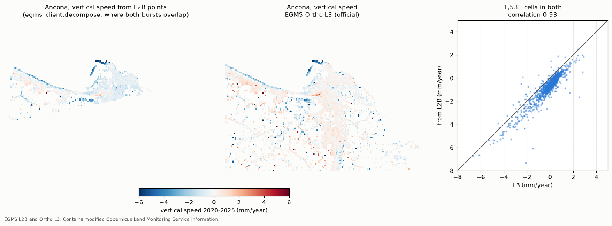
</p>

### Cells for a model: missing stays missing, signs stay

A model works on cells (1 km squares, say), not on 100 m pixels. `cells`
gives, for each cell, what its pixels say: the vertical median and its tails
(`vertical_p10`: the pixels sinking most), the east-west median, the signed
vertical acceleration, the seasonality, how many pixels have a value, and a
score.

```python
import pandas as pd

from egms_client.cells import on_grid, per_cell, square_cells, to_frame
from egms_client.mosaic import mosaic

box = dict(minx=4_450_000, miny=2_010_000, maxx=4_470_000, maxy=2_030_000)  # EPSG:3035
# up_tiffs, east_tiffs: the L3 tiles over the box, from fetch_tile (component U, then E)
up = mosaic(up_tiffs, **box)
east = mosaic(east_tiffs, **box)
attributes = pd.read_parquet("egms/EGMS_L3_E44N20_100km_U_2020_2025_1.parquet")
stats = per_cell(
    square_cells(**box, size_m=1_000),
    up,
    east,
    acceleration=on_grid(attributes, "acceleration", up),
    seasonality=on_grid(attributes, "seasonality", up),
    rmse=on_grid(attributes, "rmse_ts", up),
)
table = to_frame(stats)  # one row per cell; NaN where not measured, never 0
```

Three rules a model breaks easily. A cell with no pixel gives `None`, not
0.0: in the Foresta Umbra 74 % of the kilometres are not measured, and 0.0
would call them still. The acceleration keeps its sign: on the Rione Terra
kilometre it is +16.8 mm/year² (the uplift speeds up), at the Murge -0.02
(still). The magnitude `sqrt(E² + U²)` gives 1.24 at the Murge: noise made
positive. Every statistic uses the same pixels, those with a velocity.

### Always use the newest release, and know what it covers

```python
from datetime import date

from egms_client.releases import age_days, window

release = (await archive.releases())[-1]  # sorted oldest first
w = window(release)  # level L3 by default
print(w.text())  # 2020-12-09 to 2025-11-19: not the years of the name
print(age_days(w, date.today()))  # how old the newest measurement is
```

A release is named by years, but its window is shorter: the 2020-2025 L3
series start on 9 December 2020. Where the dates have not been read from a
file yet, `window` says so (`exact` is `False`) instead of guessing.
`egms releases --check` exits 1 when the archive lists a release this
version has not seen: the weekly live check runs the same test.

### Handle errors

```python
from egms_client import EgmsError

try:
    path = await archive.fetch_tile((47, 19), "U", "2020-2025", Path("egms"))
except EgmsError as exc:
    # The archive or the token endpoint answered, but refused:
    # bad key, expired search, missing GeoTIFF in the ZIP...
    print("EGMS said no:", exc)
except httpx.HTTPError as exc:
    # Network problems still failing after 3 retries.
    print("network:", exc)
```

### Bring your own HTTP (sync example)

No `asyncio`? Every step is a plain function:

```python
import time
from pathlib import Path

import httpx

from egms_client import (
    ARCHIVE_URL,
    ServiceKey,
    check_download,
    download_url,
    extract_tiff,
    latest_hit,
    parse_search,
    parse_token,
    search_body,
    token_request,
)

key = ServiceKey.from_json(Path("clms-service-key.json").read_text())

with httpx.Client(timeout=120) as http:
    now = time.time()
    r = http.post(
        key.token_uri, data=token_request(key, now=int(now)), headers={"Accept": "application/json"}
    )
    token = parse_token(r.status_code, r.content, now=now)

    r = http.post(
        f"{ARCHIVE_URL}/search",
        headers=token.headers(),
        json=search_body((47, 19), "U", "2020-2025"),
    )
    search = parse_search(r.content)  # None: tile at sea
    hit = latest_hit(search) if search else None

    if search and hit:
        r = http.get(download_url(ARCHIVE_URL, hit), params={"id": search.id})
        tiff = extract_tiff(check_download(r.status_code, r.content), hit)
        Path(f"{hit.stem}.tiff").write_bytes(tiff)
```

---

## The traps we already fell into

The EGMS Explorer is built for clicking. The API behind it works, but the
parts that matter are undocumented, and each one fails **quietly**. This
library handles all of these for you:

| You try | What actually happens | What egms-client does |
|---|---|---|
| any call without a login | HTTP **200** with `{"status": false, "message": "Please log in…"}` | raises `EgmsError` |
| the `id` in a download link as a credential | it is the id of a **search**, and it expires: HTTP 401 | searches, then downloads right away |
| a tile at sea | `status: false` and `Invalid tile ID`, not an empty result | returns `None`, remembers it |
| building the file name yourself | the trailing `_1` is a sub-release that can change | reads the name from the search hit |
| a malformed token request | HTTP **500** `DecodeError`, not 401: retrying won't help | raises `EgmsError` with the message |
| comparing CRS by name | four 2020-2025 tiles say `IGNF:ETRS89LAEA`, not `EPSG:3035` | compares projection parameters |
| expecting 2021-2025 after 2020-2024 | the next release was 2020-2025: windows grow | lists releases from the API |
| asking for level `L2a` as in the file names | `Invalid level`: the API wants `L2A` | uses the API's names |
| relative orbit `22` | `Invalid relative orbit`: it must be the string `"022"` | pads it for you |
| a bbox in any other shape than `[[w, s], [e, n]]` | `An error occurred processing the search` | builds the right shape |
| a box of 7° × 7° | `Requested area is too large` (5° × 5° passes) | splits it and merges the results |
| reading `2020-2025` as Jan 2020 – Dec 2025 | the L3 series run from **9 Dec 2020** to **19 Nov 2025** | `releases.window("2020-2025")` gives the real dates |
| filling a cell with no pixel with 0.0 | a forest becomes "still ground" for a model | `cells.per_cell` gives `None` and `valid_pixels == 0` |
| a valid token, now and then | HTTP **200** `Please log in` (once in 15 calls on 23 Nov 2026) | asks for a new token and tries once more |
| a third download at the same time | HTTP **429** `At most 2 downloads may be performed simultaneously` (per account) | never more than 2 at once, whatever you ask |

All checked against the live archive on 3 November 2026.

---

## API at a glance

| Name | What it does |
|---|---|
| `ServiceKey.from_env()` | The key from `EGMS_SERVICE_KEY` or `EGMS_SERVICE_KEY_FILE`. |
| `ServiceKey.from_file(path)` / `.from_json(text)` | The key from a file or a string. |
| `EgmsArchive(client=None, key=None)` | The async client; opens its own HTTP client and reads the key from the environment if not given. |
| `.releases()` / `.levels()` / `.bursts()` | What the archive publishes. |
| `Query(levels, release, bbox=, tile=, relative_orbit=, ...)` | What to look for. |
| `.find(query)` | The matching files, latest version of each; nothing downloaded. |
| `.fetch(query, dir, keep=, concurrency=, max_bytes=, on_progress=)` | Download them, skipping what is on disk; `on_plan`, `on_progress`, `on_file` report as it goes. |
| `.search(tile, component, release)` | One search; `None` if the tile does not exist. |
| `.fetch_tile(tile, component, release, dir)` | GeoTIFF path (cached), or `None`. |
| `.velocity_at(lon, lat, component=, release=, dir)` | The L3 velocity of the cell at a point, with its file (`PointVelocity`). |
| `egms_client.sync.Archive` | The same methods without `async`, for scripts and notebooks. |
| `egms mcp` / `mcp_server.create_server()` | EGMS as tools for AI agents (extra `mcp`). |
| `tiles_for_bounds(minx, miny, maxx, maxy)` | Tiles covering a rectangle (EPSG:3035 m). |
| `tile_for_point(x, y)` | The tile containing a point (EPSG:3035 m). |
| `tile_id((e, n))` / `parse_tile_id(text)` | `(47, 19)` ↔ `"E47N19"`. |
| `hit.covers(lon, lat)` / `hit.footprint` | Whether a file's real outline contains a point (bursts are tilted, their bbox is larger). |
| `default_directory()` | Where downloads go when no directory is given. |
| `mosaic(tiffs, minx=, miny=, maxx=, maxy=)` | One float32 array, NaN where no data. |
| `decompose.grid_los(points, minx=, ...)` / `decompose.decompose(asc, desc)` | L2 points on a grid; ascending + descending into vertical and east-west `Mosaic`s. |
| `to_cog(mosaic, path)` / `lonlat_to_laea(w, s, e, n)` | A mosaic as Cloud-Optimized GeoTIFF; a box in degrees as EPSG:3035 metres. |
| `tables.read_csv(path, series=, columns=)` | A CSV as a pandas DataFrame (extra `tables`). |
| `tables.dates(df)` / `.attributes(df)` / `.series_long(df)` | Its dates, its attributes, its series one row per date. |
| `tables.csv_to_geoparquet(csv)` / `.to_geoparquet(df, path)` | GeoParquet, points in EPSG:3035. |
| `mosaic.to_xarray(m)` / `tables.to_xarray(df)` | A map over `(y, x)`, series over `(pid, time)`, as `xarray.DataArray` (extra `xarray`). |
| `analysis.fit(df, start=, end=)` / `.trend_change(df)` / `.unwrapping_jumps(df)` | The archive's model on any window, with the seasonal peak; the date a velocity changes; ±27.7 mm processing steps. |
| `reliability.trust(tiffs, lon, lat, attributes=)` / `.coverage_map(values)` | How far to trust the velocity at a point: score, coverage, reasons, regional median; the coverage of every cell of a grid. |
| `facts.velocity(tiffs, lon, lat, release=)` / `.area(...)` / `.moving_points(...)` | Answers as data for people and agents: every number with release, window, files, reliability, licence, notes. |
| `check.words(facts, lang)` / `.check_text` / `.check_signs` / `.check_claims` | A text in English or Italian that only quotes the facts; checks for invented numbers, flipped signs, swaps. |
| `cells.per_cell(cells, up, east, acceleration=, seasonality=, rmse=)` / `.square_cells(...)` / `.on_grid(frame, column, like)` / `.to_frame(stats)` | Per-cell statistics for a model: medians and tails with their sign, signed acceleration on the velocity's pixels, valid pixels, score; `None` where not measured. |
| `releases.window(release, level)` / `.age_days(w, today)` / `.new_releases(published)` | The real dates a release covers; how old it is; releases this version has not seen (`egms releases --check`). |
| `EgmsError` | The server answered, but refused. |

Lower level, for your own HTTP layer: `token_request` / `parse_token`,
`search_body` / `parse_search` / `latest_hit`, `parse_releases`,
`download_url` / `check_download` / `extract_tiff`.

---

## With an AI assistant

### As tools: an MCP server

`egms mcp` (extra `mcp`) serves EGMS as tools to any
[MCP](https://modelcontextprotocol.io/) client: Claude Desktop, Claude Code,
IDE assistants. Ask "is the ground moving under Pozzuoli?" and the answer
is computed from the data:

| Tool | What it returns |
|---|---|
| `releases` | the published releases |
| `find_files(west, south, east, north, level)` | the files over a box and their size; nothing downloaded |
| `velocity_at(lon, lat, component)` | the L3 velocity of the 100 m cell at a point, how far to trust it, its surroundings |
| `area_summary(west, south, east, north, component)` | coverage, mean, percentiles, share sinking / rising, the 5 fastest cells |
| `moving_points(west, south, east, north, component, threshold)` | the cells that move against the median of the box, each reliable or not |
| `check_answer(text, facts, lang)` | the numbers of a text the facts do not hold, the wrong signs, the swaps |

Every answer is **facts** ([`egms_client.facts`](https://agentengineering.it/egms-client/api/facts/)):
each number with its release, its window (when the satellites measured),
the files it was read from, how far to trust it, the licence and notes. The
server's instructions tell the model to quote numbers only as returned, to
keep their sign, to say how far to trust them and when the data stop, never
to turn a velocity into a safety verdict, and to pass its text to
`check_answer` before answering. `area_summary` and `moving_points`
download at most `--max-tiles` L3 tiles per box (9 by default, about 60 MB
each, kept for the next call). The key stays in the server's environment
and never enters the conversation.

### Words that only quote the facts

```python
from egms_client.check import check_claims, check_signs, check_text, words

text = words(facts, "it")  # a template: every number is one of the facts
check_text(model_text, facts)  # numbers the facts do not hold
check_signs(model_text, facts)  # "sinks by 4.5" where the facts give +4.5
```

From a shell: `egms check answer.md facts.json --lang it` (exit 1 on any
problem). A fidelity set of 6 questions, scored offline in CI, measures
what the checks catch: in hand-written answers with known faults, they
catch 8 of 17 faults without a model. What they miss are swaps (a real
number said of the wrong fact) and "0.0" for a place not measured. See
[the AI layer](https://agentengineering.it/egms-client/ai/).

In Claude Code:

```bash
claude mcp add egms -e EGMS_SERVICE_KEY_FILE=$HOME/clms-service-key.json \
  -- uvx --from "egms-client[mcp]" egms mcp
```

In Claude Desktop (`claude_desktop_config.json`), or any client that
launches a command:

```json
{
  "mcpServers": {
    "egms": {
      "command": "uvx",
      "args": ["--from", "egms-client[mcp]", "egms", "mcp"],
      "env": { "EGMS_SERVICE_KEY_FILE": "/path/to/clms-service-key.json" }
    }
  }
}
```

### As documentation: `llms.txt` and a skill

The site publishes the documentation in the forms AI assistants read:

- [`llms.txt`](https://agentengineering.it/egms-client/llms.txt): an index
  of the site ([llmstxt.org](https://llmstxt.org/));
- [`llms-full.txt`](https://agentengineering.it/egms-client/llms-full.txt):
  every page in one plain-text file, with the API reference rendered from
  the docstrings;
- an **agent skill**,
  [`skills/egms-client/SKILL.md`](https://github.com/agent-engineering-studio/egms-client/blob/main/skills/egms-client/SKILL.md):
  how to use the library, and the rules of the archive a model gets wrong
  when it writes EGMS code from memory.

To give the skill to Claude Code, copy it into your project (or into
`~/.claude/skills/` for every project):

```bash
mkdir -p .claude/skills/egms-client
curl -o .claude/skills/egms-client/SKILL.md \
  https://agentengineering.it/egms-client/skills/egms-client/SKILL.md
```

All three are rebuilt from the sources with the site, and a test checks
that every name the skill uses exists in the library.

---

## Contributing

Full documentation, with the API reference: **https://agentengineering.it/egms-client/**

Contributions of every size are welcome, from a typo to a new feature. You
don't need to be an InSAR expert: most of the code is plain Python, HTTP and
files.

```bash
git clone https://github.com/agent-engineering-studio/egms-client
cd egms-client
uv sync          # install everything, dev tools included
make check       # ruff + mypy --strict + pytest, the same gate as CI
```

The tests **do not need a service key or network**: they run against
recorded answers of the real archive in [`tests/fixtures/`](https://github.com/agent-engineering-studio/egms-client/tree/main/tests/fixtures).

```text
egms-client/
├── src/egms_client/
│   ├── auth.py      # service key → JWT → bearer token
│   ├── archive.py   # tiles, search, download: pure functions
│   ├── client.py    # EgmsArchive: async client, cache, token renewal
│   ├── mosaic.py    # tiles → one array, Cloud-Optimized GeoTIFF (extra: raster)
│   ├── tables.py    # CSVs → pandas, GeoParquet (extra: tables)
│   ├── cli.py       # the `egms` command
│   └── errors.py    # EgmsError
└── tests/
    ├── fixtures/    # real archive answers, for offline tests
    └── live/        # the same behaviour, checked weekly on the real archive
```

The archive's API is undocumented, so a **weekly workflow**
(`.github/workflows/live.yml`) runs `tests/live` against the real archive
and opens an issue if something changed. To run it yourself:
`EGMS_LIVE=1 EGMS_SERVICE_KEY_FILE=~/clms-service-key.json uv run pytest tests/live`.

How to propose a change:


Rules are short: see [CONTRIBUTING.md](https://github.com/agent-engineering-studio/egms-client/blob/main/CONTRIBUTING.md). Commits follow
[Conventional Commits](https://www.conventionalcommits.org/), coverage stays
above 90%, and contributions are accepted under Apache-2.0.

### Ideas to work on

Not promises, just directions where help would make a difference. Open an
issue to discuss one before starting.

The [roadmap](https://agentengineering.it/egms-client/roadmap/) goes further:
time-series analysis and AI features (an MCP server, `llms.txt`, reports
that cite their data).

| Idea | Why it matters | Good for |
|---|---|---|
| 📓 **More example notebooks** (a coastline, a dam, a mine) | Show what the data can do | first contribution, GIS users |
| 🧭 **North component and uncertainties** in `decompose` (a third geometry, `mean_velocity_std`) | Closer to L3, with error bars | advanced, InSAR users |
| 📚 **Tutorials on the documentation site** (a page per recipe, with figures) | Easier to follow than one long README | anyone |

Found something odd in the archive? That is a contribution too: open an issue
with what you sent and what came back.

---

## Data licence and credits

EGMS data is © European Union, Copernicus Land Monitoring Service, free and
open under the [Copernicus data policy](https://land.copernicus.eu/en/data-policy).
Anything you publish from it **must credit the source**, for example:

> Contains modified Copernicus Land Monitoring Service information (EGMS), © European Union.

The images in this README are illustrations, not EGMS data.

Code: [Apache-2.0](https://github.com/agent-engineering-studio/egms-client/blob/main/LICENSE). Extracted from
[Limen](https://github.com/agent-engineering-studio/limen).

If this project is useful to you, a ⭐ on GitHub helps others find it.
