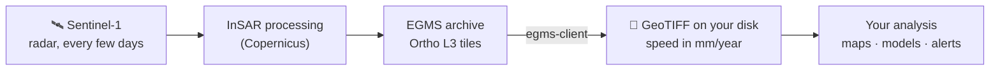
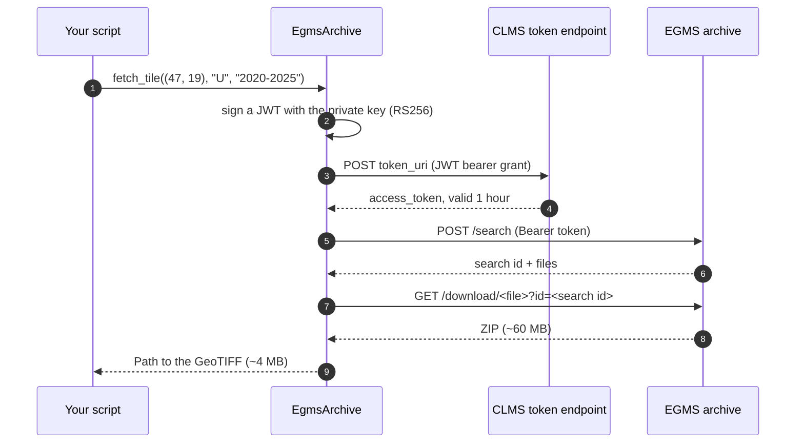
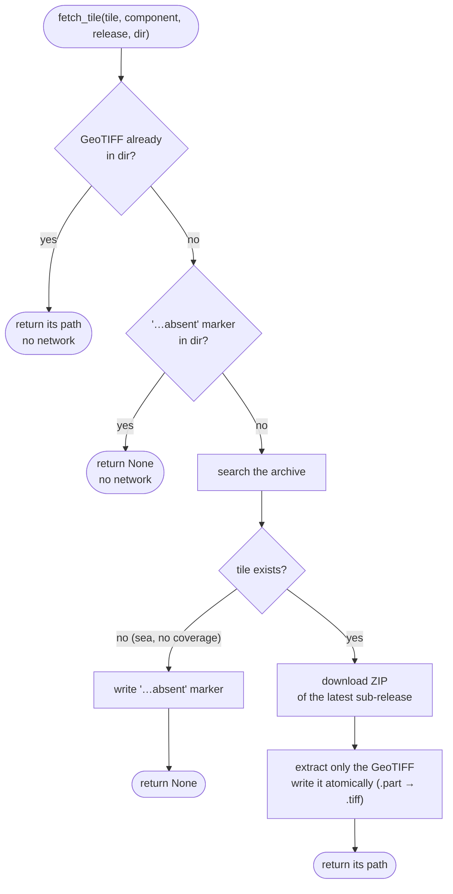
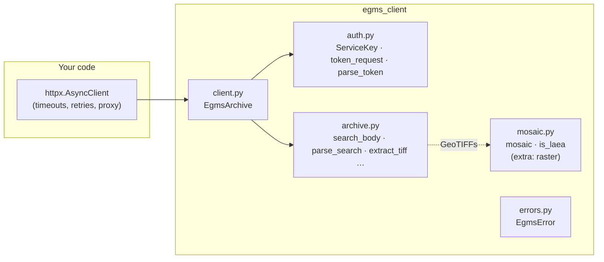
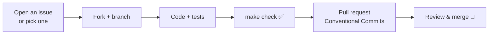

<p align="center">
  
</p>

<p align="center">
  <a href="https://github.com/agent-engineering-studio/egms-client/actions/workflows/ci.yml"></a>
  <a href="https://pypi.org/project/egms-client/"></a>
  
  
  <a href="./LICENSE"></a>
</p>

**egms-client** is a small, typed, async Python library for the archive of
[EGMS](https://egms.land.copernicus.eu/), the **European Ground Motion
Service**. EGMS measures how much the ground moves, millimetre by millimetre,
across all of Europe, using radar satellites. This library lets you download
that data from a script, with no browser and no copy-pasted links.

```python
path = await archive.fetch_tile((47, 19), "U", "2020-2025", Path("egms"))
# egms/EGMS_L3_E47N19_100km_U_2020_2025_1.tiff  (vertical speed, mm/year)
```

---

## Contents

- [What is EGMS, in 30 seconds](#what-is-egms-in-30-seconds)
- [What this library does](#what-this-library-does)
- [Who is it for](#who-is-it-for)
- [Quick start](#quick-start)
- [How it works](#how-it-works)
- [Recipes](#recipes)
- [The traps we already fell into](#the-traps-we-already-fell-into)
- [API at a glance](#api-at-a-glance)
- [Contributing](#contributing) · [Ideas to work on](#ideas-to-work-on)
- [Data licence and credits](#data-licence-and-credits)

---

## What is EGMS, in 30 seconds

The Sentinel-1 satellites fly over Europe every few days and send down radar
pulses. Comparing the echoes from one pass to the next (a technique called
**InSAR**) shows whether a point on the ground moved closer or farther, down
to a few millimetres. Copernicus turns years of these measurements into
**maps of speed**: how fast the ground goes up or down, east or west, in
**millimetres per year**.



What you can see with it, for example:

- a **town that is sinking** because groundwater is pumped out (subsidence);
- a **slope that creeps** downhill before a landslide;
- a **bridge, dam or railway** that settles more than it should;
- the ground **rising** above a volcano or a gas storage site.

> Negative vertical speed (`U < 0`) means the ground goes **down**;
> positive means it goes **up**.

## What this library does

| | Feature | In plain words |
|---|---|---|
| 🔑 | **Login with a CLMS service key** | Your key file is all it needs. Tokens are created and renewed for you. |
| 🔎 | **Search and download Ortho L3 tiles** | Vertical (`U`) and east-west (`E`) speed on a 100 m grid, in 100 km squares. |
| 💾 | **Disk cache** | It keeps the 4 MB map, drops the 60 MB ZIP, and remembers tiles that do not exist (at sea). Run it twice: the second run asks the server nothing. |
| 🧩 | **Mosaics** | Glue tiles into one array over any rectangle, with no resampling. |
| 🧪 | **Pure functions too** | Every step is also a plain function, if you have your own HTTP stack. |

## Who is it for

- **Researchers and students** in geology, geophysics and remote sensing who
  want EGMS data in a notebook or pipeline.
- **GIS and data engineers** who need to download a region or a whole
  country, repeatably.
- **Risk and infrastructure teams** (landslides, subsidence, monitoring of
  roads, railways, dams) who use ground motion as one input among many.

It started inside [Limen](https://github.com/agent-engineering-studio/limen),
where the vertical and east-west speeds of each 1 km cell are features of a
landslide-risk model, and was extracted so that anyone can use it.

---

## Quick start

### 1. Install

```bash
pip install egms-client           # login, search, download
pip install "egms-client[raster]" # + mosaics (numpy, rasterio, pyproj)
```

Python 3.12 or newer.

### 2. Get a service key (once, 2 minutes)

1. Go to [land.copernicus.eu](https://land.copernicus.eu/) and sign in with **EU Login**.
2. Open your profile → **API Tokens** → *Create new token*.
3. Save the JSON file you get, e.g. as `clms-service-key.json`.

It contains `client_id`, `user_id`, `private_key` and `token_uri`, and it
**does not expire**. Treat it like a password: keep it out of git.

```bash
echo "clms-service-key.json" >> .gitignore
```

### 3. Download your first tile

```python
import asyncio
from pathlib import Path

import httpx

from egms_client import EgmsArchive, ServiceKey

key = ServiceKey.from_json(Path("clms-service-key.json").read_text())


async def main() -> None:
    async with httpx.AsyncClient(timeout=120) as client:
        archive = EgmsArchive(client, key)

        print(await archive.releases())  # ['2020-2024', '2020-2025']

        path = await archive.fetch_tile((47, 19), "U", "2020-2025", Path("egms"))
        print(path)  # egms/EGMS_L3_E47N19_100km_U_2020_2025_1.tiff


asyncio.run(main())
```

That's it: `path` is a GeoTIFF of 1,000 × 1,000 pixels, each one the mean
vertical speed of a 100 m square, in mm/year.

### 4. Make a mosaic and look at it

```python
from egms_client import tiles_for_bounds
from egms_client.mosaic import mosaic

# A rectangle in EPSG:3035 metres (here: exactly tile E47N19)
bounds = dict(minx=4_700_000, miny=1_900_000, maxx=4_799_999, maxy=1_999_999)


async def download(archive: EgmsArchive) -> list[Path]:
    tiffs = []
    for tile in tiles_for_bounds(*bounds.values()):
        path = await archive.fetch_tile(tile, "U", "2020-2025", Path("egms"))
        if path is not None:  # None: the tile is at sea or not covered
            tiffs.append(path)
    return tiffs


# ... after downloading:
vertical = mosaic(tiffs, **bounds)
print(vertical.values.shape, vertical.left, vertical.top)
# (1000, 1000) 4700000.0 2000000.0
```

Want a picture? With `pip install matplotlib`:

```python
import matplotlib.pyplot as plt

rows, cols = vertical.values.shape
extent = (
    vertical.left,
    vertical.left + cols * vertical.pixel,
    vertical.top - rows * vertical.pixel,
    vertical.top,
)
plt.imshow(vertical.values, cmap="RdBu_r", vmin=-10, vmax=10, extent=extent)
plt.colorbar(label="vertical speed (mm/year)")  # blue: sinking, red: rising
plt.title("EGMS Ortho L3 · E47N19 · 2020-2025")
plt.show()
```

---

## How it works

### Tiles: how Europe is cut into squares

The Ortho L3 product lives on a single grid in **EPSG:3035** (the standard
equal-area projection for Europe). The grid is cut into 100 km squares, and
each square is named after its **lower-left corner, in hundreds of
kilometres**.

<p align="center">
  
</p>

You never have to compute tile names by hand: give `tiles_for_bounds` a
rectangle and it returns every tile it touches.

```python
>>> tiles_for_bounds(4_530_000, 1_740_000, 4_670_000, 1_870_000)
[(45, 17), (45, 18), (46, 17), (46, 18)]
>>> tile_id((47, 19))
'E47N19'
```

### Logging in: the service key never leaves your machine

Your key signs a short-lived request (a JWT); the Copernicus server answers
with a token valid for one hour. `EgmsArchive` asks for a new one **five
minutes before it expires**, so a download of a whole country, which takes
longer than an hour, never stops halfway.



### Downloading: what `fetch_tile` decides



Because **both** outcomes are written to disk, running the same script again
over a whole country sends **zero requests**. And because the file is first
written as `.part` and then renamed, an interrupted run never leaves a
half-written GeoTIFF behind.

### Why it keeps only the GeoTIFF

<p align="center">
  
</p>

Each ZIP also holds a CSV with the full time series of every pixel. It is
large and most uses only need the mean speed, so the library leaves it out.
(Need the time series? See [Ideas to work on](#ideas-to-work-on).)

### The building blocks

The library has two layers. You can use the high-level client, or call the
pure functions with any HTTP library you like.



- **`auth.py`, `archive.py`**: pure functions, no network. They build
  requests and read answers. Easy to test, easy to reuse.
- **`client.py`**: `EgmsArchive` wires them to **your** `httpx.AsyncClient`.
  Timeouts, retries and proxies stay under your control.
- **`mosaic.py`**: optional, only needs `numpy`, `rasterio`, `pyproj`.

---

## Recipes

### Download a whole region, both components

```python
for component in ("U", "E"):  # vertical, east-west
    for tile in tiles_for_bounds(4_300_000, 1_500_000, 5_200_000, 2_700_000):
        await archive.fetch_tile(tile, component, "2020-2025", Path("egms"))
```

Stop it and start it again whenever you like: finished tiles are skipped.

### Always use the newest release

```python
release = (await archive.releases())[-1]  # sorted oldest first
```

### Handle errors

```python
from egms_client import EgmsError

try:
    path = await archive.fetch_tile((47, 19), "U", "2020-2025", Path("egms"))
except EgmsError as exc:
    # The archive or the token endpoint answered, but refused:
    # bad key, expired search, missing GeoTIFF in the ZIP...
    print("EGMS said no:", exc)
except httpx.HTTPError as exc:
    # Network problems and HTTP error codes: your retry policy decides.
    print("network:", exc)
```

### Bring your own HTTP (sync example)

No `asyncio`? Every step is a plain function:

```python
import time
from pathlib import Path

import httpx

from egms_client import (
    ARCHIVE_URL,
    ServiceKey,
    check_download,
    download_url,
    extract_tiff,
    latest_hit,
    parse_search,
    parse_token,
    search_body,
    token_request,
)

key = ServiceKey.from_json(Path("clms-service-key.json").read_text())

with httpx.Client(timeout=120) as http:
    now = time.time()
    r = http.post(
        key.token_uri, data=token_request(key, now=int(now)), headers={"Accept": "application/json"}
    )
    token = parse_token(r.status_code, r.content, now=now)

    r = http.post(
        f"{ARCHIVE_URL}/search",
        headers=token.headers(),
        json=search_body((47, 19), "U", "2020-2025"),
    )
    search = parse_search(r.content)  # None: tile at sea
    hit = latest_hit(search) if search else None

    if search and hit:
        r = http.get(download_url(ARCHIVE_URL, hit), params={"id": search.id})
        tiff = extract_tiff(check_download(r.status_code, r.content), hit)
        Path(f"{hit.stem}.tiff").write_bytes(tiff)
```

---

## The traps we already fell into

The EGMS Explorer is built for clicking. The API behind it works, but the
parts that matter are undocumented, and each one fails **quietly**. This
library handles all of these for you:

| You try | What actually happens | What egms-client does |
|---|---|---|
| any call without a login | HTTP **200** with `{"status": false, "message": "Please log in…"}` | raises `EgmsError` |
| the `id` in a download link as a credential | it is the id of a **search**, and it expires: HTTP 401 | searches, then downloads right away |
| a tile at sea | `status: false` and `Invalid tile ID`, not an empty result | returns `None`, remembers it |
| building the file name yourself | the trailing `_1` is a sub-release that can change | reads the name from the search hit |
| a malformed token request | HTTP **500** `DecodeError`, not 401: retrying won't help | raises `EgmsError` with the message |
| comparing CRS by name | four 2020-2025 tiles say `IGNF:ETRS89LAEA`, not `EPSG:3035` | compares projection parameters |
| expecting 2021-2025 after 2020-2024 | the next release was 2020-2025: windows grow | lists releases from the API |

All checked against the live archive on 3 November 2026.

---

## API at a glance

| Name | What it does |
|---|---|
| `ServiceKey.from_json(text)` | Read your CLMS key file. |
| `EgmsArchive(client, key)` | The async client. |
| `.releases()` | Published releases, oldest first. |
| `.search(tile, component, release)` | One search; `None` if the tile does not exist. |
| `.fetch_tile(tile, component, release, dir)` | GeoTIFF path (cached), or `None`. |
| `tiles_for_bounds(minx, miny, maxx, maxy)` | Tiles covering a rectangle (EPSG:3035 m). |
| `tile_id((e, n))` | `(47, 19)` → `"E47N19"`. |
| `mosaic(tiffs, minx=, miny=, maxx=, maxy=)` | One float32 array, NaN where no data. |
| `EgmsError` | The server answered, but refused. |

Lower level, for your own HTTP layer: `token_request` / `parse_token`,
`search_body` / `parse_search` / `latest_hit`, `parse_releases`,
`download_url` / `check_download` / `extract_tiff`.

---

## Contributing

Contributions of every size are welcome, from a typo to a new feature. You
don't need to be an InSAR expert: most of the code is plain Python, HTTP and
files.

```bash
git clone https://github.com/agent-engineering-studio/egms-client
cd egms-client
uv sync          # install everything, dev tools included
make check       # ruff + mypy --strict + pytest, the same gate as CI
```

The tests **do not need a service key or network**: they run against
recorded answers of the real archive in [`tests/fixtures/`](tests/fixtures/).

```text
egms-client/
├── src/egms_client/
│   ├── auth.py      # service key → JWT → bearer token
│   ├── archive.py   # tiles, search, download: pure functions
│   ├── client.py    # EgmsArchive: async client, cache, token renewal
│   ├── mosaic.py    # tiles → one array (extra: raster)
│   └── errors.py    # EgmsError
└── tests/
    └── fixtures/    # real archive answers, for offline tests
```

How to propose a change:



Rules are short: see [CONTRIBUTING.md](./CONTRIBUTING.md). Commits follow
[Conventional Commits](https://www.conventionalcommits.org/), coverage stays
above 90%, and contributions are accepted under Apache-2.0.

### Ideas to work on

Not promises, just directions where help would make a difference. Open an
issue to discuss one before starting.

| Idea | Why it matters | Good for |
|---|---|---|
| 🖥️ **Command-line tool** (`egms fetch --bbox ...`) | Download without writing Python | first contribution |
| 📓 **Example notebooks** (a city, a landslide, a coastline) | Show what the data can do | first contribution, GIS users |
| 🗺️ **Bounds from lat/lon** | Most people don't think in EPSG:3035 | first contribution |
| 📈 **Keep the CSV time series** as an option | Speed over time, not only the mean | intermediate |
| 🛰️ **Other EGMS products** (L2a, L2b, Calibrated) | Point measurements, more detail | intermediate, InSAR users |
| 🧊 **Export to xarray / Cloud-Optimized GeoTIFF** | Plug into the scientific Python stack | intermediate |
| ⚡ **Parallel downloads** with a concurrency limit | A country in minutes, not hours | intermediate |
| 📚 **Documentation site** | Search, API reference, tutorials | anyone |

Found something odd in the archive? That is a contribution too: open an issue
with what you sent and what came back.

---

## Data licence and credits

EGMS data is © European Union, Copernicus Land Monitoring Service, free and
open under the [Copernicus data policy](https://land.copernicus.eu/en/data-policy).
Anything you publish from it **must credit the source**, for example:

> Contains modified Copernicus Land Monitoring Service information (EGMS), © European Union.

The images in this README are illustrations, not EGMS data.

Code: [Apache-2.0](./LICENSE). Extracted from
[Limen](https://github.com/agent-engineering-studio/limen).

If this project is useful to you, a ⭐ on GitHub helps others find it.
