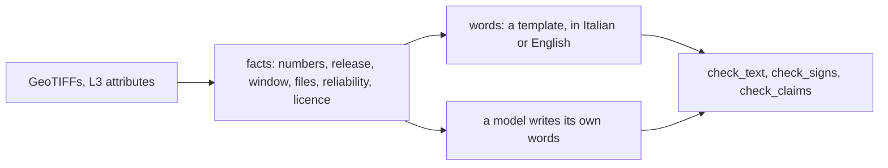

# The AI layer: facts first, then words

A language model is good with words and bad with numbers it did not read.
So in egms-client a model never makes a number. The library computes the
answer, as data; the model only words it; and the library reads the words
back.

## Facts

[`egms_client.facts`](api/facts.md) answers three questions, from local
files, with no network:

- `velocity(tiffs, lon, lat, release=)`: the velocity of the 100 m cell at a
  point, how far to trust it, and the median of its surroundings;
- `area(tiffs, box, release=)`: statistics over a box;
- `moving_points(tiffs, box, release=)`: the cells that move against the
  median of the box, each reliable or not.

Each answer is a plain dict. Next to every number: `release`, `window`
(the first and last acquisition: the data stop there), `files`,
`reliability`, `licence`, and `notes` (not measured is not zero; a velocity
is not an alert). A place with no cell has `measured: false` and `null`,
never 0. The [MCP server](api/mcp.md) returns these dicts.

## Words and checks

[`egms_client.check`](api/check.md):

- `words(facts, lang)` writes the answer from a template, in English or
  Italian. Before it returns, the text is checked: a template that quoted
  a number the facts do not hold would raise.
- `check_text(text, facts)`: every number of the text is a figure of the
  facts, to the decimals written (`145` and `145.2` both match 145.24).
- `check_signs(text, facts)`: a number said to go down (*sinks by 4.5*,
  *scende di 4,5*, `-4.5`) is negative in the facts, and the reverse. For
  ground motion the sign is the worst fault: the number exists, the meaning
  is upside down.
- `check_claims(text, facts)`: in the template's sentences, each number is
  the one of *its* fact. It finds the swap "the median is +118.9" where
  118.9 is the velocity against the median.

The MCP tool `check_answer` and the command `egms check answer.md
facts.json` run all three.

## How faithful: the fidelity set

[`benchmarks/faithful.json`](https://github.com/agent-engineering-studio/egms-client/blob/main/benchmarks/faithful.json)
has 6 questions, 3 in Italian and 3 in English: Rione Terra, the gulf of
Pozzuoli (not measured), Bologna (area and moving cells), the Murge
east-west, the Posatora slope. Their facts come from the benchmark crops.
Each question has two answers written by hand: one faithful, one with known
faults. For every number, a label says which fact it is said of, and
`score` says what the number is:

- `faithful`, `approximate` (8,600 for 8,588), `question`: not faults;
- `unmeasured`: a number for a fact that is null ("0,0 mm/anno" in the sea);
- `sign`: the right value going the wrong way;
- `rounded`, `swapped` (another fact's number), `invented`.

CI runs `python -m benchmarks.faithful score --check`. It fails if a hand
answer does not score as written, or if the facts change.

| Author | Answers | Numbers | faithful | approximate | question | unmeasured | sign | rounded | swapped | invented | faults the checks miss |
|---|---|---|---|---|---|---|---|---|---|---|---|
| hand | 6 | 57 | 57 | 0 | 0 | 0 | 0 | 0 | 0 | 0 | - |
| hand-faults | 6 | 27 | 9 | 1 | 0 | 1 | 3 | 0 | 8 | 5 | 9 of 17 |

What is not faithful:
- rione-terra, hand-faults: 145.3 (invented, said of velocity_mm_per_year); 118.9 (swapped, said of regional.median_mm_per_year); 0.76 (swapped, said of reliability.score); 12 (swapped, said of window.last); 31 (invented, said of window.last)
- gulf-of-pozzuoli, hand-faults: 0,0 (unmeasured, said of velocity_mm_per_year); 0,5 (swapped, said of reliability.score); 1 (swapped, said of None)
- bologna-area, hand-faults: 6,3 (sign, said of median); 61 (invented, said of share_below)
- bologna-moving, hand-faults: 27.9 (sign, said of cells.0.velocity_mm_per_year); 11.39311 (swapped, said of cells.0.lon); 44.58065 (swapped, said of cells.0.lat)
- murge-east, hand-faults: 1.7 (sign, said of median); 2,000 (invented, said of cells_with_data)
- posatora, hand-faults: 9,4 (invented, said of velocity_mm_per_year); 60 (swapped, said of reliability.coverage)

**Check:** the faithful answers score 57 of 57. In the answers with faults,
the checks without a model (`check_text` and `check_signs`) catch 8 of 17
faults: all 5 invented numbers and all 3 flipped signs.

**What it taught.** The 9 faults the checks miss are 8 swaps and 1
"unmeasured": a real number, said of the wrong fact. "0,0" for the sea at
Pozzuoli passes `check_text`, because 0.0 is in the facts (the coverage).
In free text, only a reader that knows what each number is about can catch
these. For our own template, `check_claims` does it. For a model's text, a
second model labels each number and the scorer does the arithmetic.

## What is not there

- **A model's answers.** `ask` (a model answers the 6 questions) and
  `label` (a second model says what each number is of) are written but not
  run: they cost money and run only when the maintainer says so. Until then
  the table has hand answers only, and how often a model is faithful is
  **not measured**.
- **Meaning beyond numbers.** "390 cells are not reliable", where the facts
  say 390 are reliable, scores as faithful: the number is right and the
  words are wrong. No check here reads that.
- **Thresholds read as directions.** "498 cells sink 5.0 mm/year or more"
  turns a threshold (any direction) into a descent, and `check_signs`
  flags it. A model should say "move".
- **Six questions.** Enough to test the scorer, not to rank models.

*Data: EGMS, © European Union, Copernicus Land Monitoring Service.*
