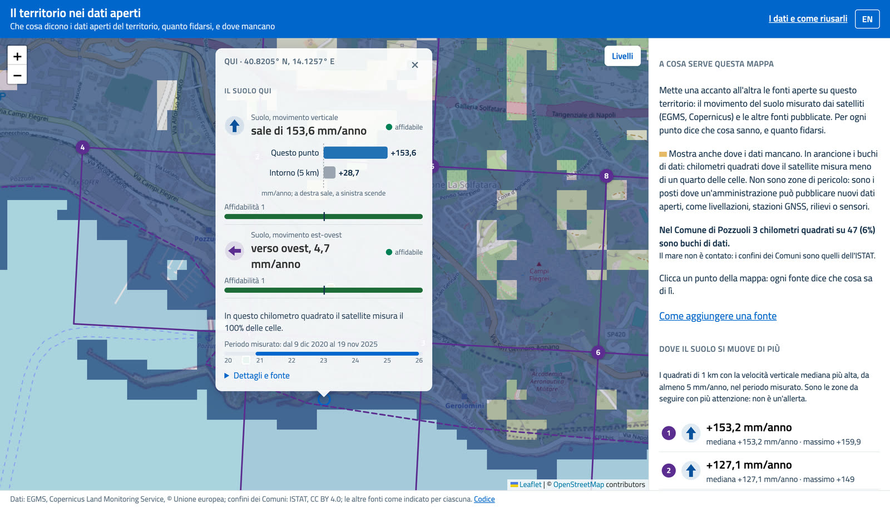
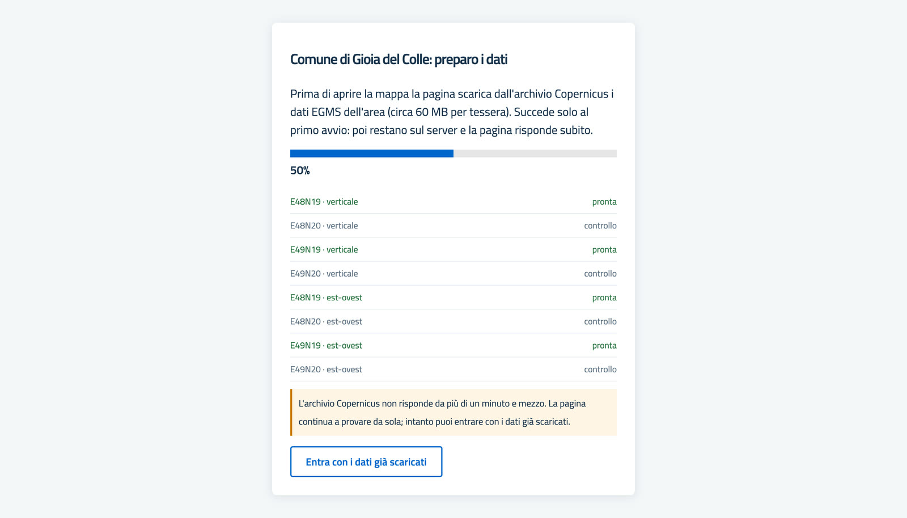
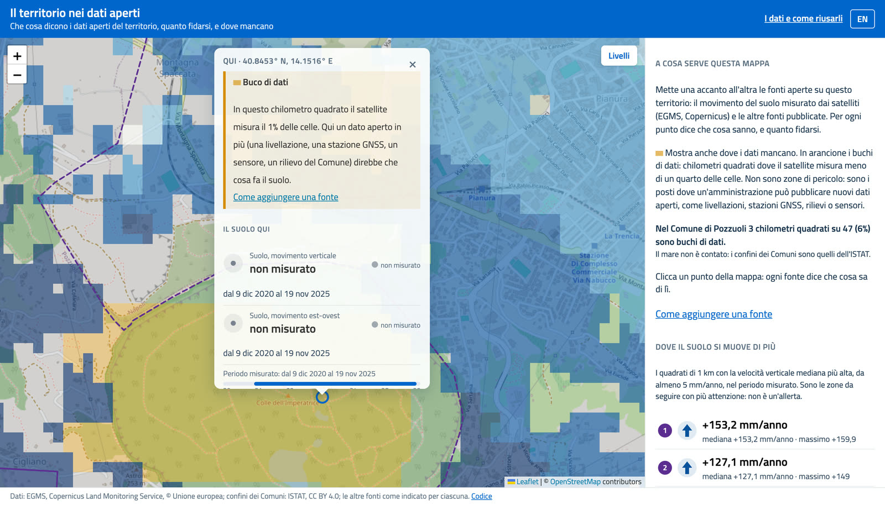
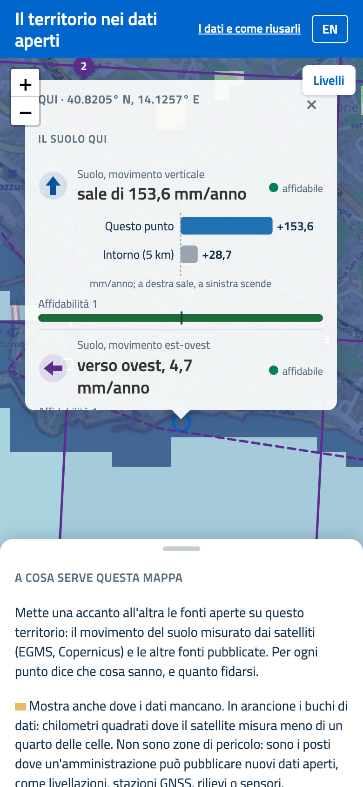

# Riuso nella Pubblica Amministrazione

egms-client legge i dati aperti dell'European Ground Motion Service (EGMS),
il servizio Copernicus che misura dallo spazio quanto si muove il terreno in
tutta Europa, e li rende usabili da chiunque. Questa pagina è per un ente che
vuole usarlo: che cosa trova pronto, che cosa resta a lui, e come il progetto
entra nel Catalogo del software di Developers Italia.



<video controls preload="none" poster="../images/ui-territorio-video.jpg" width="100%">
  <source src="../images/ui-territorio.mp4" type="video/mp4">
  <a href="../images/ui-territorio.mp4">Il video della pagina, 30 secondi</a>
</video>

*Trenta secondi sulla pagina: la classifica delle zone, la scheda di un punto, un buco di dati, la versione inglese.*

## Che cosa trova pronto

- Le mappe della **velocità verticale** ed **est-ovest** del terreno, in
  millimetri all'anno, una cella ogni 100 metri, su qualsiasi area.
- I **punti di misura** con la loro serie temporale, come tabelle e
  GeoParquet, da aprire in QGIS.
- Le serie che **accelerano** o **cambiano velocità**, e gli errori di
  elaborazione da non scambiare per movimento.
- **Quanto fidarsi** di ogni numero: quante celle intorno hanno una misura,
  quanto la serie segue il modello, e la velocità rispetto alla zona.
- Una **pagina per il sito del Comune**, in italiano e in inglese, da
  installare con Docker e da incorporare in un iframe (sotto): i dati
  aperti del territorio uno accanto all'altro, e come sono fatti.
- Un **formato aperto per i dati di ogni fonte**, i
  [record](api/records.md): un sensore o un file del Comune compaiono
  nella pagina senza scrivere codice.
- Un **server MCP** perché un assistente AI risponda con i numeri dei dati,
  citando release, date e file.

Serve una chiave di servizio gratuita del Copernicus Land Monitoring Service
(CLMS): come ottenerla è nella [pagina iniziale](index.md#2-get-a-service-key-once-2-minutes).

## La pagina per il sito del Comune

Una mappa del territorio a tutto schermo. Si clicca un punto, e sulla mappa
si apre una scheda, leggermente trasparente: il movimento del suolo in parole
(«sale di 145,2 mm/anno») con una freccia, un grafico che lo confronta con la
mediana dei 5 km intorno, una barra per l'affidabilità, il periodo misurato e,
più sotto, le altre fonti vicine (una serie, come un pluviometro, ha la sua
linea). «Dettagli e fonte» apre fonte, date, licenza e note. Il pannello a
lato spiega a che cosa serve la mappa; sul telefono è un foglio che sale dal
basso.

**Dove il suolo si muove di più.** Sulla mappa, numerati, gli otto quadrati
di 1 km con la velocità verticale mediana più alta (almeno 5 mm/anno), contati
solo dove EGMS misura almeno un quarto delle celle; il pannello li elenca in
classifica, e un clic apre la scheda del punto. Sono le zone da seguire con
più attenzione. Non sono un'allerta: la parola sui rischi resta della
Protezione Civile.

Le fonti restano una accanto all'altra: la pagina non le mescola in un
punteggio e non è un sistema di allerta. Mostra i dati e i loro limiti.

**Il primo avvio.** All'avvio l'API scarica le tessere EGMS dell'area (circa
60 MB l'una). Finché non sono pronte, la pagina mostra una schermata di
caricamento con una barra di avanzamento e lo stato di ogni tessera; alla fine
si apre la mappa. Le volte dopo le tessere sono già sul server e la pagina si
apre subito. Se l'archivio Copernicus non risponde per più di un minuto e
mezzo, la schermata lo dice e permette di entrare con i dati già scaricati;
intanto il download continua a riprovare da solo.



**I buchi di dati.** La mappa mostra anche dove i dati mancano. L'area è
divisa in quadrati di 1 km sulla griglia europea (EPSG:3035). Un quadrato
dove EGMS misura meno di un quarto delle celle di 100 m è un buco di dati, in
arancione. Il satellite misura solo dove trova riflettori stabili (edifici,
strade, roccia): nei campi e nei boschi spesso non misura. Un buco di dati
non è una zona di pericolo. È il posto dove l'amministrazione può pubblicare
un dato aperto in più: una livellazione, una stazione GNSS, un sensore, un
rilievo. Il pannello conta i buchi del Comune, e la scheda di un punto dice
se il suo quadrato è un buco. Un quadrato di una tessera non ancora
scaricata non è contato: non sapere non è un buco.



**Il mare e i confini del Comune.** EGMS non misura mai il mare, che quindi
sembrerebbe un buco di dati. Per questo la pagina usa i confini dei Comuni
dell'ISTAT (versione generalizzata al 1 gennaio 2025, CC BY 4.0, circa
10 MB): li scarica al primo avvio insieme alle tessere e li tiene sul server.
Si contano solo i quadrati per almeno il 10% a terra, e solo le loro celle a
terra; i buchi del Comune sono i quadrati per più di metà dentro i suoi
confini, disegnati sulla mappa. Se i confini non si possono scaricare la
pagina funziona lo stesso, e avverte che il mare viene contato.

**La pagina dei dati** (`/dati`) raccoglie la parte tecnica: come è fatta
ogni fonte, il codice per riusarla, il formato dei record, i template da
scaricare (JSON e CSV) e le regole.



**Aggiungere una fonte.** Una fonte entra nella pagina scrivendo i suoi dati
come [record](api/records.md), un formato JSON aperto, oppure come tabella
CSV con le colonne del template (`tempo, lon, lat, grandezza, valore, unità,
fonte, licenza`, più `sensore`, `etichetta` e `significato` facoltative).
Chi gestisce la pagina lo carica dal backoffice (sotto), oppure lo mette
nella cartella `records/` del server (o in quella di `EGMS_RECORDS_DIR`); la
pagina lo legge alla richiesta successiva. Un file con un record non valido
è rifiutato per intero. Il file si controlla prima con `egms records FILE`.

**Installarla.** Serve Docker. Dal repository:

```bash
cp .env.example .env        # e scrivere luogo, nome e lingua del Comune
make up                     # oppure: docker compose up -d
```

La pagina risponde su `http://127.0.0.1:3003`. Le porte ascoltano solo sul
computer stesso: per pubblicarla serve un proxy con HTTPS davanti.

**Le impostazioni**, tutte nel file `.env`:

| Variabile | Che cosa fa |
|---|---|
| `EGMS_UI_LAT`, `EGMS_UI_LON` | il Comune: il centro dell'area della pagina (di base Pozzuoli, Rione Terra: 40,8225 N 14,1205 E) |
| `EGMS_UI_RADIUS_KM` | il raggio dell'area, da 1 a 20 km (di base 10) |
| `EGMS_UI_ZOOM` | lo zoom con cui si apre su un punto dato nell'indirizzo |
| `EGMS_UI_PLACE` | il nome nell'intestazione, per esempio `"Comune di Pozzuoli"` |
| `EGMS_UI_LANG` | `it` o `en`; chi visita può cambiare |
| `EGMS_UI_FRAME_ANCESTORS` | i siti che possono mostrarla in un iframe |
| `EGMS_UI_TILES`, `EGMS_UI_TILES_CREDIT` | la mappa di sfondo (di base OpenStreetMap) |
| `EGMS_RECORDS_DIR` | la cartella dei record delle altre fonti (di base `records/`), in sola lettura |
| `EGMS_ADMIN_USER`, `EGMS_ADMIN_PASSWORD_HASH` | l'amministratore del backoffice (senza, il backoffice è spento) |
| `EGMS_ADMIN_PORT` | la porta del backoffice su 127.0.0.1 (di base 3004) |
| `EGMS_UI_PUBLIC_URL` | l'indirizzo pubblico della pagina, per l'esempio dei sensori |

Gli stessi valori si possono dare nell'indirizzo:
`?lat=40.82&lon=14.12&place=Comune%20di%20Pozzuoli&lang=it`.

**Nel sito del Comune**, con `EGMS_UI_FRAME_ANCESTORS=https://www.comune.example.it`:

```html
<iframe src="https://egms.comune.example.it/?embed=1" width="100%" height="640"
        title="Il suolo si muove?" style="border:0"></iframe>
```

Con `embed=1` la pagina toglie intestazione e piè di pagina. La mappa
riempie l'iframe e si ingrandisce con la rotella del mouse.

**Il backoffice** è per chi gestisce la pagina: caricare file, collegare
sensori, vedere che cosa è stato rifiutato e perché. Risponde su
`http://127.0.0.1:3004`, una porta diversa da quella della pagina, che il
proxy pubblico non deve pubblicare: ci si arriva dalla rete dell'ente o con
un tunnel SSH. È spento finché nel `.env` non ci sono l'utente e l'hash
della password dell'amministratore:

```bash
make admin-password            # chiede la password e stampa l'hash
# nel file .env:
EGMS_ADMIN_USER=ente
EGMS_ADMIN_PASSWORD_HASH=scrypt:32768:8:1:...
EGMS_UI_PUBLIC_URL=https://territorio.comune.example.it
```

La password non è mai nel `.env`, solo il suo hash. Dopo 5 tentativi
sbagliati dallo stesso indirizzo il backoffice aspetta 15 minuti; la sessione
dura 8 ore. Il registro tiene ogni accesso, caricamento e modifica, mai
password o token.

- **Carica un file**: un `.json`, `.jsonl` o `.csv`; il backoffice lo
  controlla, mostra i record e lo salva solo se si conferma.
- **Sensori**: si registra un sensore (che cosa misura, dove, fonte,
  licenza, valori ammessi) e il backoffice dà il suo token, una volta sola.
  Il sensore invia le letture a `POST /api/ingest/ID` della pagina pubblica,
  in SenML (RFC 8428, il formato dei sensori di Limen) o come record, con
  `Authorization: Bearer TOKEN`; al massimo una richiesta al secondo e 64
  KB. Un sensore si spegne, riceve un nuovo token o si elimina con un clic.
- **Fonti**: tutti i file da cui la mappa si alimenta, con i record e i
  motivi dei rifiuti; quelli caricati e quelli dei sensori si possono
  eliminare.

**La chiave CLMS** va nella cartella `secrets/` (montata in sola lettura, mai
copiata nell'immagine). Senza chiave la pagina parte in **modalità
dimostrativa**, sui ritagli del benchmark (Pozzuoli, Bologna, Murge, Foresta
Umbra, Ancona): fuori da lì dice «nessun dato caricato», che non è «non
misurato».

**Un'area sola.** La pagina lavora su un'area: il Comune e un raggio intorno
(`EGMS_UI_RADIUS_KM`, di base 10 km). La mappa resta lì: non si sposta e non
si allontana oltre, e fuori è velata. Fuori dall'area la pagina non legge
dati: ogni zona nuova vorrebbe dire scaricare dall'archivio.

**Che cosa scarica.** All'avvio, le tessere L3 che coprono l'area (circa 60
MB l'una, verticale ed est-ovest), in background. Restano nel volume
`egms-data`: le volte dopo non scarica niente. Se l'archivio Copernicus non
risponde, la pagina usa i file già scaricati e l'ultima release nota, e
riprova dopo dieci minuti.

## Che cosa resta all'ente

Il progetto dà il software. Queste cose sono di chi lo usa.

- **Non è un'allerta.** Una velocità del terreno è una misura, non un
  giudizio sulla sicurezza di un edificio, di un versante o di un'area. Per
  il pericolo valgono le comunicazioni ufficiali della Protezione Civile.
- **Che cosa i dati non vedono.** Dove ci sono bosco, campi arati o neve il
  satellite trova pochi punti o nessuno: lì la risposta è «non misurato», non
  zero. I movimenti molto rapidi si perdono, e quello nord-sud non si vede.
  I numeri descrivono la finestra della release (oggi 2020-2025), non il
  terreno di oggi.
- **Attribuzione dei dati.** I dati EGMS sono © Unione europea, Copernicus
  Land Monitoring Service, liberi e aperti secondo la
  [politica dei dati Copernicus](https://land.copernicus.eu/en/data-policy).
  Chi pubblica qualcosa ricavato da questi dati deve citarne la fonte, per
  esempio: «Contiene informazioni modificate del Copernicus Land Monitoring
  Service (EGMS), © Unione europea».
- **La chiave CLMS.** È personale e non scade: va tenuta come una password,
  fuori dal codice e dai repository, in una variabile d'ambiente o in un
  segreto di Docker.
- **Dati personali.** La pagina pubblica non ne raccoglie: niente account,
  niente cookie. Il backoffice usa un cookie tecnico di sessione, solo per
  l'amministratore, e registra l'indirizzo IP di chi accede. Su disco restano solo i file scaricati dall'archivio.

## Intelligenza artificiale

I numeri della libreria sono calcolati dai dati con codice aperto e
verificato. Un modello linguistico non produce mai un numero: lo riceve
come dato, con release, date, file e affidabilità. Il server MCP dà a un
assistente AI questi dati, e le sue istruzioni gli chiedono di citarli come
sono, di mantenere il segno, di dire quanto fidarsi e di non trasformare mai
una velocità in un giudizio di sicurezza. Prima di rispondere, l'assistente
può controllare il suo testo con `check_answer`, che trova i numeri inventati
e i segni rovesciati. Le frasi della pagina del Comune non usano un modello:
sono frasi fisse in cui la libreria inserisce i numeri dei dati, e vengono
ricontrollate prima di uscire. La classe di
rischio, la valutazione d'impatto e l'informativa agli utenti riguardano
l'uso che l'ente ne fa, e sono sue.

## Il Catalogo di Developers Italia

**Oggi: software open source di terze parti.** Il codice non è di una PA.
Entra nel Catalogo con il file [`publiccode.yml`](https://github.com/agent-engineering-studio/egms-client/blob/main/publiccode.yml)
nel repository, con `codiceIPA` vuoto, e una segnalazione sul repository
[`italia/catalogo-software`](https://github.com/italia/catalogo-software).

**Domani: software a riuso.** Se un ente lo adotta e ne diventa titolare (art.
69 del CAD), lo dichiara con l'[onboarding](https://onboarding.developers.italia.it/)
di Developers Italia; `codiceIPA` prende il codice dell'ente, e gli enti che
lo usano vanno in `usedBy`.

- [x] Repository pubblico, licenza Apache-2.0
- [x] README, documentazione, `CONTRIBUTING.md`, `CHANGELOG.md`
- [x] `publiccode.yml` valido per il validatore ufficiale, controllato a ogni modifica dalla CI
- [x] Installazione con Docker e pagina per il Comune con Bootstrap Italia
- [ ] Segnalazione su `italia/catalogo-software`

## Fonti

- [Developers Italia: pubblicare software per la PA](https://developers.italia.it/it/guide/pubblicare-software-per-la-pa)
- [Lo standard publiccode.yml](https://yml.publiccode.tools/)
- [EGMS](https://egms.land.copernicus.eu/) e la [politica dei dati Copernicus](https://land.copernicus.eu/en/data-policy)
