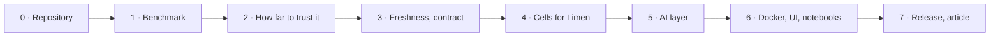

# Roadmap

egms-client gets EGMS data well. The work now is to say **how far to trust
it**, to prove it on places where the answer is known, and to make it usable
by a public body and by an AI agent without inventing numbers. The plan is
tracked in [#22](https://github.com/agent-engineering-studio/egms-client/issues/22),
one pull request per phase.

!!! warning "Ground rules"
    The numbers come from the data, computed by code that is tested. A
    language model never produces a velocity, a date or a place. Not
    measured is not zero. A ground velocity is a measurement, not an alert:
    for danger, the official word is the Civil Protection's.

## Where it started (0.7.0)

Search and download with the CLMS key, mosaics, tables and GeoParquet,
L2 → vertical and east-west (`decompose`), time-series analysis, an MCP
server, `llms.txt` and a skill. [Limen](https://github.com/agent-engineering-studio/limen)
uses the pure functions and `mosaic` for its landslide features. Measured
there (limen#380): the EGMS features alone separate landslide cells from
the others with an AUC of 0.48-0.54, so they carry no weight in the rules.

## 0 · The repository like the other libraries ✅

`publiccode.yml` checked in CI, [`riuso.md`](riuso.md) for public bodies, a
test that the package imports neither Limen nor its other libraries, a
Makefile with `help`.

**Check:** CI green with the publiccode parser and the import ban.

## 1 · A benchmark of known places ✅

Five places, with ranges from sources outside EGMS, scored offline in CI on
9.5 MB of crops of the real archive. See the [benchmark](benchmark.md).

**Check:** 11 of 13 at first.

**What it taught.** A still place is not at zero: the Murge move +1.6
mm/year east-west, a regional offset. Two checks stay failing to say so.

## 2 · How far to trust it ✅

[`reliability.trust`](api/reliability.md): coverage of the neighbourhood,
the fit of the series, a score, the reasons, and the velocity against its
region. An estimate made from outside, declared as such.

**Check:** 18 of 20 on the benchmark. The forest scores 0, a lone cell in
it 0.03, every measured place 0.79 or more.

**What is not there.** Motion too fast for InSAR, north-south motion,
anything after the release window. The archive's formal error
(`mean_velocity_std`) is reported, not trusted: it is at most 0.2 mm/year
in a forest where 99 % of the cells are empty.

**For Limen:** a cell with a value is not a measured cell. Limen counts
pixels with a value; with `coverage_map` it can tell a lone cell from a
measured neighbourhood, and keep both apart from "not measured".

## 3 · Freshness and the archive's contract ✅

[`releases.window`](api/releases.md) gives the real dates of a release; the
MCP answers carry them. `egms releases --check` and three new live checks
notice a new release, a reprocessed tile (`_2`) or a changed answer.

**Check:** the 2020-2025 L3 window is 2020-12-09 to 2025-11-19, read from
the files. The live check passed 14 of 15 on its first run: the archive
answered a valid token with "Please log in" once. It did not happen again
in 10 local calls. The client now asks for a new token and tries once more.

**What is not there.** The window of 2020-2024 (not read from a file yet:
`window` says the years only). A test of the download links over time.

**For Limen:**
- Limen stores `period_start` = 1 January of the first year. The real
  window starts on 9 December 2020: eleven months earlier than any EGMS
  measurement. Use `releases.window`.
- Limen's own client class (`Archivio`) re-implements what `EgmsArchive`
  already does: the cache, the sea marker, a new search after a 401, and
  now the new token after "Please log in". With `EgmsArchive(retries=0)`
  inside Limen's own retry, the class can go.

## 4 · Cells for a model

Per-cell statistics over any grid, NaN kept as NaN, signed acceleration on
the same pixels as velocity, a parity test against Limen's aggregation.

**For Limen** (issues to open there): not measured stays NULL instead of
0.0; no EGMS feature for a landslide before the release window starts;
signed acceleration; the backtest with and without EGMS (limen#618).

## 5 · The AI layer

`facts` (answers as data with release, window, reliability, licence), MCP
tools on top of them, `check_text` against invented or swapped numbers, a
fidelity set scored offline, `llms.txt` and the skill updated.

## 6 · Docker, a page for a Comune, notebooks

`docker compose up` with containers named `egms-client-*`; a page with
Bootstrap Italia, in Italian and English, set up per Comune, embeddable,
narrow: how much the ground moves there, where, and how far to trust it.
More notebooks, `make notebooks`.

## 7 · Release 0.8.0 and the fourth episode

The release on PyPI, Limen's pin, the fourth episode of the Open Data series
on [agentengineering.it](https://agentengineering.it/), which closes the
landslide chapter.
