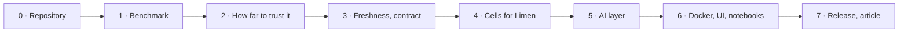

# Roadmap

egms-client gets EGMS data well. The work now is to say **how far to trust
it**, to prove it on places where the answer is known, and to make it usable
by a public body and by an AI agent without inventing numbers. The plan is
tracked in [#22](https://github.com/agent-engineering-studio/egms-client/issues/22),
one pull request per phase.

!!! warning "Ground rules"
    The numbers come from the data, computed by code that is tested. A
    language model never produces a velocity, a date or a place. Not
    measured is not zero. A ground velocity is a measurement, not an alert:
    for danger, the official word is the Civil Protection's.

## Where it started (0.7.0)

Search and download with the CLMS key, mosaics, tables and GeoParquet,
L2 → vertical and east-west (`decompose`), time-series analysis, an MCP
server, `llms.txt` and a skill. [Limen](https://github.com/agent-engineering-studio/limen)
uses the pure functions and `mosaic` for its landslide features. Measured
there (limen#380): the EGMS features alone separate landslide cells from
the others with an AUC of 0.48-0.54, so they carry no weight in the rules.

## 0 · The repository like the other libraries ✅

`publiccode.yml` checked in CI, [`riuso.md`](riuso.md) for public bodies, a
test that the package imports neither Limen nor its other libraries, a
Makefile with `help`.

**Check:** CI green with the publiccode parser and the import ban.

## 1 · A benchmark of known places ✅

Five places, with ranges from sources outside EGMS, scored offline in CI on
9.5 MB of crops of the real archive. See the [benchmark](benchmark.md).

**Check:** 11 of 13 at first.

**What it taught.** A still place is not at zero: the Murge move +1.6
mm/year east-west, a regional offset. Two checks stay failing to say so.

## 2 · How far to trust it ✅

[`reliability.trust`](api/reliability.md): coverage of the neighbourhood,
the fit of the series, a score, the reasons, and the velocity against its
region. An estimate made from outside, declared as such.

**Check:** 18 of 20 on the benchmark. The forest scores 0, a lone cell in
it 0.03, every measured place 0.79 or more.

**What is not there.** Motion too fast for InSAR, north-south motion,
anything after the release window. The archive's formal error
(`mean_velocity_std`) is reported, not trusted: it is at most 0.2 mm/year
in a forest where 99 % of the cells are empty.

**For Limen:** a cell with a value is not a measured cell. Limen counts
pixels with a value; with `coverage_map` it can tell a lone cell from a
measured neighbourhood, and keep both apart from "not measured".

## 3 · Freshness and the archive's contract ✅

[`releases.window`](api/releases.md) gives the real dates of a release; the
MCP answers carry them. `egms releases --check` and three new live checks
notice a new release, a reprocessed tile (`_2`) or a changed answer.

**Check:** the 2020-2025 L3 window is 2020-12-09 to 2025-11-19, read from
the files. The live check passed 14 of 15 on its first run: the archive
answered a valid token with "Please log in" once. It did not happen again
in 10 local calls. The client now asks for a new token and tries once more.

**What is not there.** The window of 2020-2024 (not read from a file yet:
`window` says the years only). A test of the download links over time.

**For Limen:**
- Limen stores `period_start` = 1 January of the first year. The real
  window starts on 9 December 2020: eleven months earlier than any EGMS
  measurement. Use `releases.window`.
- Limen's own client class (`Archivio`) re-implements what `EgmsArchive`
  already does: the cache, the sea marker, a new search after a 401, and
  now the new token after "Please log in". With `EgmsArchive(retries=0)`
  inside Limen's own retry, the class can go.

## 4 · Cells for a model ✅

[`cells.per_cell`](api/cells.md): per-cell statistics over any grid of
cells. A cell with no pixel gives `None`. Medians and tails keep their sign.
The vertical acceleration is signed and uses the velocity's pixels. Each
cell gets `valid_pixels` and a score.

**Check:** the same pixels, medians and p90 as Limen's aggregation, on
random grids with unaligned cells and on the Ancona and Murge crops. Three
new benchmark checks, 21 of 23 in all. On the Rione Terra kilometre the
acceleration is +16.8 mm/year²: the uplift speeds up, as INGV says. At the
Murge the median cell is at -0.02. In the Foresta Umbra 74 % of the
kilometres have no pixel.

**What it taught.** At the still Murge, Limen's acceleration (the p90 of
`sqrt(E² + U²)`) is 1.24 mm/year² in the median cell: noise, made positive.
In the Bologna box the ground sinks by 4.0 mm/year and the acceleration is
+0.75: the sinking slows down, and a magnitude reads it as speeding up.

**What is not there.** The east-west acceleration (only the vertical is
signed and kept). Cells cut by the edge of a crop count only the pixels
inside. A check of the Bologna slowdown against a source.

**For Limen** (issues opened on 23 November 2026):
- [limen#698](https://github.com/agent-engineering-studio/limen/issues/698):
  not measured is NULL, not 0.0, when training and when serving.
- [limen#699](https://github.com/agent-engineering-studio/limen/issues/699):
  `period_start` is 1 January, but the window starts on 9 December 2020; no
  EGMS feature for a landslide outside the window.
- [limen#700](https://github.com/agent-engineering-studio/limen/issues/700):
  a signed vertical acceleration on the velocity's pixels instead of the
  magnitude; `scatterer_count` counts pixels; the AUC again, in the backtest
  with and without EGMS (limen#618), by reliability class.
- [limen#701](https://github.com/agent-engineering-studio/limen/issues/701):
  drop the `Archivio` class for `EgmsArchive(retries=0)`.

## 5 · The AI layer ✅

[Facts first, then words](ai.md). [`facts`](api/facts.md) gives answers as
data. Each number comes with its release, its window, its files, its
reliability, the licence and notes. A place with no cell is `null`, never 0.
The MCP tools return these facts. There are two new tools: `moving_points`
and `check_answer`. [`check`](api/check.md) holds `words` (a template in
Italian and English that is checked before it returns), `check_text`,
`check_signs` and `check_claims`; `egms check` runs them from a shell. A
fidelity set of 6 questions is scored offline in CI. `llms.txt` and the
skill are updated (rule 13: quote the facts, then check).

**Check:** the faithful hand answers score 57 of 57. In the answers with
known faults, the checks without a model catch 8 of 17: every invented
number and every flipped sign.

**What it taught.** The checks miss 9 of the 17 faults, all of them swaps:
a real number said of the wrong fact. One of them is "0,0" for the sea at
Pozzuoli, which passes because 0.0 is in the facts (the coverage). That is
why the scorer labels each number with its fact, and why the template has
`check_claims`.

**What is not there.** A model's answers: `ask` and `label` are written
but not run, because they are paid calls and wait for the maintainer's
yes. How faithful a model is, is **not measured** yet. Meaning beyond
numbers ("390 not reliable" for 390 reliable) is not checked.

**For Limen:** Limen's reviewer (`fedelta`) can reuse `check_signs` and the
`unmeasured` rule. A sign flipped on a ground velocity, or "0" for a place
not measured, is the fault that matters most for a risk text, and here the
first is caught without a model.

## 6 · Docker, a page for a Comune, notebooks ✅

`docker compose up` (or `make up`) starts four containers, named
`egms-client-*`, on ports that the other libraries do not use, all on
127.0.0.1:

- `egms-client-ui` (3003): the page;
- `egms-client-api` (internal): `demo/api.py`, `facts` and `words` behind a few URLs;
- `egms-client-notebook` (8889): JupyterLab;
- `egms-client-mcp` (8768): the MCP server over HTTP.

Every setting is in `.env`, and `.env.example` names them all; a test
checks it. The CLMS key is mounted read-only and never copied into an
image; a test checks that it never reaches the logs. The page uses Bootstrap
Italia from npm, with no CDN. It is in Italian and English, set per Comune
from `.env` or from the address, and embeddable (`frame-ancestors`,
`embed=1`). It shows the vertical velocity map, the card of a point (how
much, which way, how far to trust it, until when) and the cells that move
against their surroundings. Without a key it runs on the benchmark crops
(demo mode). Notebooks 04 (how far to trust) and 05 (cells for a model) run
on the crops, in CI. The reuse guide (`riuso.md`) says how to install and
embed the page.

**Check:** CI builds both images and starts them in demo mode. The page
answers "+145,2 mm/anno" at Rione Terra, the map comes back as a PNG, the
header allows only the configured frames, there is no key in the image and
the API does not run as root. Locally, with the real key: Gioia del Colle
gives -0.4 mm/year vertical and +1.8 east-west (2 tiles, 58 s the first
time, then from the volume). MCP over HTTP lists its 6 tools. 221 tests.

**What is not there.** A proxy with HTTPS (the ente's). Accessibility checked
with a tool (the page uses the kit's components, landmarks and
`aria-live`, but it has not been audited). The east-west map (only the card
gives it). The notebooks that download data are still not run in CI: they
need the key.

**For Limen:** nothing to take: the page is narrow on purpose, and Limen
has its own. The same `facts` and `words` can feed Limen's card for a cell,
with the same checks.

## 7 · Release 0.8.0 and the fourth episode

The release on PyPI, Limen's pin, the fourth episode of the Open Data series
on [agentengineering.it](https://agentengineering.it/), which closes the
landslide chapter.
