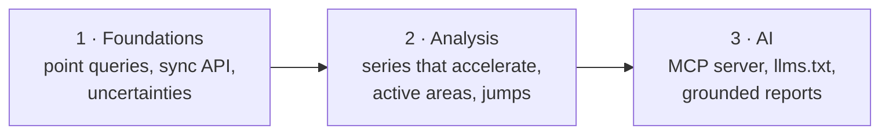

# Roadmap

Where egms-client could go next. Nothing here is a promise. The point is to
pick a direction together: open an issue before you start one of these.

Today the library **gets** EGMS data (search, download, mosaic, tables,
L2 → vertical / east-west). The next step is to help people **read** the
data, both people and AI agents. That work falls into three tracks, each
building on the one before:

!!! warning "Ground rule for every AI feature"
    The numbers come from the data, computed by code that is tested. A
    language model may choose *what* to compute and may explain it in
    words. It never produces a velocity, a date or a point id itself. Every
    answer says which file it came from, and none is presented as a hazard
    warning.

---

## 1 · Foundations

These features are useful as they are, and the AI track needs them.

| Feature | What it is | Why | Effort |
|---|---|---|---|
| **Point query** ✅ | `await archive.velocity_at(lon, lat, component="U")`: the L3 value of the 100 m cell, fetching only its tile (cached) | "How fast does the ground move *here*?" is the first question every user asks. It is also the first tool an agent needs | S |
| **Sync façade** ✅ | `egms_client.sync.Archive` wraps `EgmsArchive` with `asyncio.run`, for scripts and notebooks that do not want `await` | Removes the first stumbling block for GIS users | S |
| **Uncertainties and north** in `decompose` | propagate `mean_velocity_std`; a third geometry for N | Error bars on every map (an idea already listed in the README) | M |
| **Release diff** | `egms diff --bbox ... 2019-2023 2020-2025`: the change in velocity between two releases | The windows overlap, and an area that speeds up between releases is news | M |
| **Streaming large CSVs** | `tables.iter_csv(path, chunksize=)` → GeoParquet without loading the whole file | L2 CSVs of a dense burst do not fit in memory comfortably | M |
| **STAC items** | a STAC Item for each downloaded file | Plugs into existing EO catalogues and tools | S |
| **Tutorials on the site** | a page per recipe, with figures | An idea already listed in the README | S |

---

## 2 · Analysis of the time series

EGMS L2 points come with a series of displacements, one every 6 to 12
days. A mean velocity hides the interesting cases. The methods below are
classic, explainable signal processing and machine learning, with no
language model involved. They would go in a new module,
`egms_client.analysis` (numpy, optionally scikit-learn).

| Feature | What it finds | Method | Effort |
|---|---|---|---|
| **Acceleration** | points whose motion speeds up (often the warning sign of a landslide) | piecewise linear fit with a breakpoint, or a quadratic term, with its significance | M |
| **Seasonality** | the yearly cycle (clay soils, aquifers, thermal dilation of structures) | harmonic regression; amplitude and phase per point | S |
| **Unwrapping jumps** | steps of about ±28 mm (half the Sentinel-1 wavelength) that are processing errors, not ground motion | step detection on the differenced series | S |
| **Active deformation areas** | clusters of moving points, rather than isolated noisy ones | DBSCAN on position + velocity, above a stability threshold (the "ADA" approach in the InSAR literature) | M |
| **Anomalies** | points that behave unlike their neighbours | isolation forest on per-point features (velocity, acceleration, seasonal amplitude, coherence) | M |
| **Features for models** | per-cell features (velocity, acceleration, seasonality, share of moving points) on a regular grid | aggregation, the same as `grid_los` | S |

The last row is the one [Limen](https://github.com/agent-engineering-studio/limen)
needs for its landslide-risk model. Every method should be validated on
the three notebooks (Campi Flegrei, Ancona, Bologna), where we already know
what to expect.

---

## 3 · AI

### 3.1 An MCP server: EGMS for any agent

!!! success "Done: `releases`, `find_files`, `velocity_at`, `area_summary`"
    `egms mcp`, extra `mcp`. See
    [With an AI assistant](index.md#with-an-ai-assistant). `moving_points`
    and `map` wait for track 2.

**What.** An optional extra, `egms-client[mcp]`, with an
[MCP](https://modelcontextprotocol.io/) server, `egms mcp`. It exposes the
library as tools for Claude, Claude Code, IDE assistants or any other MCP
client:

| Tool | Built on |
|---|---|
| `releases()` | `EgmsArchive.releases` |
| `find(place or bbox, level, release)` | `Query`, `find`; the file list and its size, with nothing downloaded |
| `velocity_at(lon, lat)` | point query (track 1) |
| `area_summary(bbox)` | mosaic + statistics: share of the area sinking, percentiles, hottest cells |
| `moving_points(bbox, min_speed)` | L2 + analysis (track 2) |
| `map(bbox, component)` | `to_cog` plus a PNG preview |

**Why.** Someone can ask "is the ground moving under the A14 near Ancona?"
and get an answer computed from the data, with no Python. It is also the
fastest way to spread the library.

**Guardrails.** Downloads stay within `max_bytes` (the tool asks before
going above it). The 2-download limit and the token handling stay in the
client, where they already are. The service key is read from the
environment and never passes through the conversation. Effort: **M**.

### 3.2 `llms.txt` and a skill for coding agents

!!! success "Done"
    [`llms.txt`](https://agentengineering.it/egms-client/llms.txt),
    [`llms-full.txt`](https://agentengineering.it/egms-client/llms-full.txt)
    and the [agent skill](https://agentengineering.it/egms-client/skills/egms-client/SKILL.md)
    are published with the site. See
    [With an AI assistant](index.md#with-an-ai-assistant).

**What.** Publish `/llms.txt` and `/llms-full.txt` on this site: the API,
the recipes and the traps table, in plain text that AI assistants read.
Add an agent skill (`SKILL.md`) that tells a coding agent how to use the
library, and above all what not to do: the `_1` sub-release, the
`"022"` orbit, the 5° box, the 2 downloads.

**Why.** The traps table is the most valuable thing in this project, and
it is exactly what a model gets wrong when it writes EGMS code from memory.
Effort: **S** (generated from the docs in the `docs` workflow, so it never
goes stale).

### 3.3 Questions in plain language

**What.** `egms ask "vertical speed around Bologna, latest release"`. A
model turns the sentence into a `Query` through tool use (with a fixed
schema and no free code), the place name is geocoded by a deterministic
geocoder (Nominatim), the plan is shown with its size, and only then is
anything downloaded.

**Why.** It saves looking up tiles, orbits and boxes. **Optional and
pluggable**: the provider sits behind an interface, and the CLI works
exactly as today without it. Effort: **M**.

### 3.4 Area reports that cite their data

**What.** `egms report --bbox ...` produces a Markdown or HTML report:
maps, histograms, the fastest clusters (track 2), and a short text that
describes them. The text is generated from a JSON of computed figures, and
every number in it is checked against that JSON before the report is
written (a sentence with a number that is not there is removed).

**Why.** Municipalities and infrastructure teams need a readable summary,
and they need it to be right. Effort: **M**, after track 2.

### 3.5 Research directions

These are worth a notebook first, not a module:

- **Gap filling** on L3 with Gaussian processes (kriging), with an
  uncertainty per cell.
- **Short-term forecast** of a point's series, to flag deviations from the
  expected trend rather than to predict events.
- **Fusion** with rainfall (ERA5) or groundwater data, to separate seasonal
  causes from structural ones.

---

## Suggested order

| # | Item | Track | Effort | Unlocks |
|---|---|---|---|---|
| 1 | ~~`llms.txt` + agent skill~~ ✅ | AI | S | better AI-written code, today |
| 2 | ~~Point query + sync façade~~ ✅ | 1 | S | the MCP server, beginners |
| 3 | ~~MCP server (`find`, `velocity_at`, `area_summary`)~~ ✅ | AI | M | agents over EGMS |
| 4 | `analysis`: acceleration, seasonality, jumps | 2 | M | moving points, reports, Limen |
| 5 | Active deformation areas + MCP `moving_points` | 2 · AI | M | the most useful question |
| 6 | Uncertainties in `decompose`, release diff | 1 | M | error bars, change |
| 7 | `egms ask`, `egms report` | AI | M | non-programmers |

*Sizes: S is a few days, M a week or two, both including tests and docs.*
