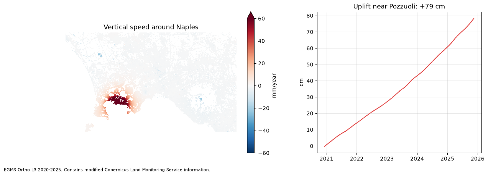

# Example notebooks

Three stories told with real EGMS data, from download to figure. Each one downloads only what it
needs (less than 350 MB), once: run it again and nothing is downloaded.

| Notebook | What it shows | Data | Download |
|---|---|---|---|
| [`01_campi_flegrei.ipynb`](https://github.com/agent-engineering-studio/egms-client/blob/main/notebooks/01_campi_flegrei.ipynb) | The caldera west of Naples rising by up to 16 cm a year, and +79 cm in five years near Pozzuoli | L3 map + one tile's time series (GeoParquet) | ~290 MB |
| [`02_landslide_ancona.ipynb`](https://github.com/agent-engineering-studio/egms-client/blob/main/notebooks/02_landslide_ancona.ipynb) | Measurement points around the Posatora landslide in Ancona, moving points against still ones | L2B, one ascending and one descending burst | ~170 MB |
| [`03_sinking_bologna.ipynb`](https://github.com/agent-engineering-studio/egms-client/blob/main/notebooks/03_sinking_bologna.ipynb) | Subsidence below Bologna and the plain: how much of the area sinks, and how fast | L3 map | ~270 MB |

<p align="center">
  
</p>

## Run them

```bash
pip install "egms-client[raster,tables,xarray]" matplotlib jupyter
export EGMS_SERVICE_KEY_FILE=~/clms-service-key.json   # see the main README
export EGMS_DATA_DIR=~/egms-data                       # where downloads are kept (optional)
jupyter lab
```

The notebooks are stored without outputs. Each one saves its figure in `docs/images/`.

*Data: EGMS, © European Union, Copernicus Land Monitoring Service.*
