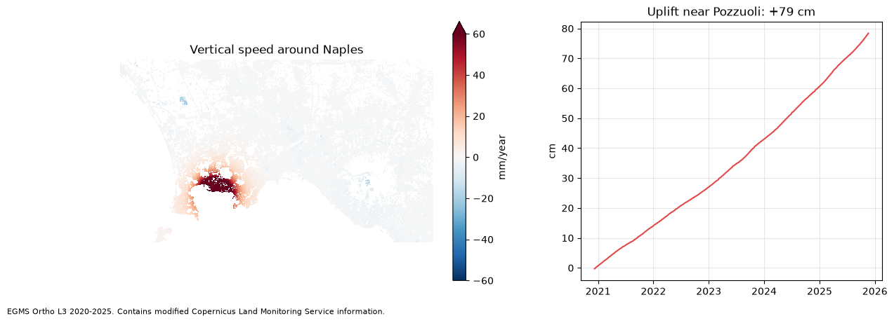

# Example notebooks

Five stories told with real EGMS data, from download to figure. The first three download only
what they need (less than 350 MB), once: run them again and nothing is downloaded. The last two
run on the crops of the benchmark in `benchmarks/data/`: no key, no download, and CI runs them.

| Notebook | What it shows | Data | Download |
|---|---|---|---|
| [`01_campi_flegrei.ipynb`](https://github.com/agent-engineering-studio/egms-client/blob/main/notebooks/01_campi_flegrei.ipynb) | The caldera west of Naples rising by up to 16 cm a year, and +79 cm in five years near Pozzuoli | L3 map + one tile's time series (GeoParquet) | ~290 MB |
| [`02_landslide_ancona.ipynb`](https://github.com/agent-engineering-studio/egms-client/blob/main/notebooks/02_landslide_ancona.ipynb) | Measurement points around the Posatora landslide in Ancona, moving points against still ones | L2B, one ascending and one descending burst | ~170 MB |
| [`03_sinking_bologna.ipynb`](https://github.com/agent-engineering-studio/egms-client/blob/main/notebooks/03_sinking_bologna.ipynb) | Subsidence below Bologna and the plain: how much of the area sinks, and how fast | L3 map | ~270 MB |
| [`04_how_much_to_trust.ipynb`](https://github.com/agent-engineering-studio/egms-client/blob/main/notebooks/04_how_much_to_trust.ipynb) | How far to trust a velocity: Rione Terra (score 1), the sea (not measured), a lone forest cell (0.03); coverage cell by cell; the Murge, still but not at zero | benchmark crops | none |
| [`05_cells_for_a_model.ipynb`](https://github.com/agent-engineering-studio/egms-client/blob/main/notebooks/05_cells_for_a_model.ipynb) | Per-km statistics for a model: 74 % of the forest not measured; the signed acceleration (median -0.01 at the Murge) against its magnitude (1.24) | benchmark crops | none |

<p align="center">
  
</p>

## Run them

```bash
make notebooks-offline                                 # 04 and 05: no key
make notebooks                                         # all five (needs the key)
docker compose --profile notebook up                   # or JupyterLab in Docker, on 127.0.0.1:8889
```

Or by hand:

```bash
pip install "egms-client[raster,tables,xarray]" matplotlib jupyter
export EGMS_SERVICE_KEY_FILE=~/clms-service-key.json   # see the main README
export EGMS_DATA_DIR=~/egms-data                       # where downloads are kept (optional)
jupyter lab
```

The notebooks are stored without outputs. Each one saves its figure in `docs/images/`.

*Data: EGMS, © European Union, Copernicus Land Monitoring Service.*
